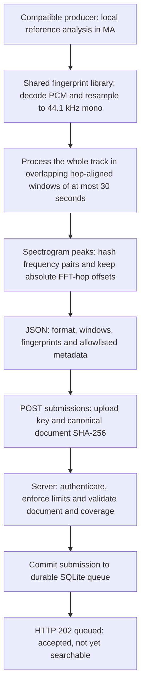
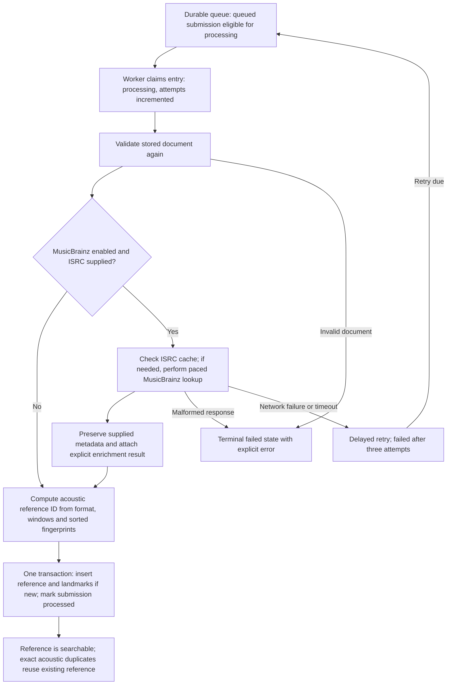
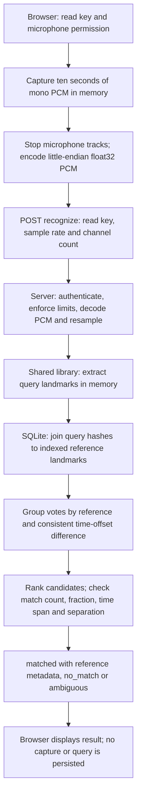
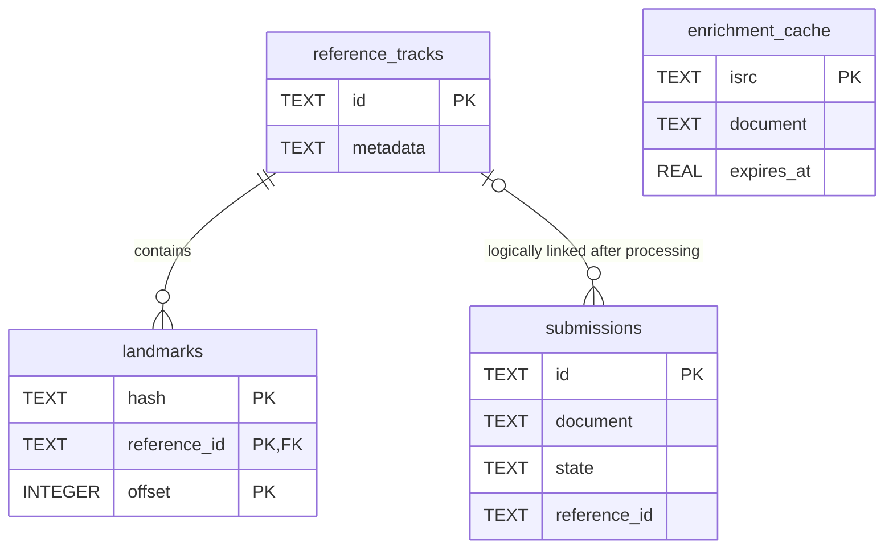
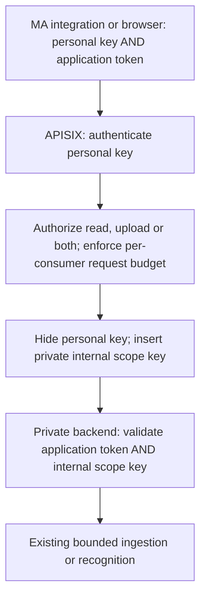

# Audio Fingerprint Server

An independent experimental service compatible with Music Assistant fingerprint submissions.
This is not an official Music Assistant or Open Home Foundation (OHF) project, and no
endorsement or adoption is implied. Future integration would require agreement with the
respective maintainers. Music Assistant names below describe compatibility, not ownership.
The existing package/directory names and fingerprint format identifier remain unchanged
for now, so installation and protocol compatibility are preserved.

Licensed under [MIT](LICENSE). The shared library is available at
[dmoo500/audio-fingerprint](https://github.com/dmoo500/audio-fingerprint).
Its exact Git revision is pinned because there is no PyPI release.

The old analysis server is not modified.
It accepts the MA `dejavu_analysis` provider's full-track `ma-dejavu-landmarks-v2` fingerprints
and legacy sampled `ma-dejavu-landmarks-v1` documents,
durably queues them and publishes validated references atomically. A local microphone
page tests recognition against those references. No original provider audio is requested
or stored; microphone PCM is processed in memory and discarded.

## How it works

There are two separate paths: contributors build the reference collection by submitting
fingerprints; listeners query that collection with a short microphone capture. Recognition
does **not** add the microphone recording to the collection or learn an unknown song.
The server does not crawl a music catalogue or fetch reference audio itself.

### 1. Read reference audio and submit fingerprints

Reference extraction happens on the producer side, not in this server. The compatible
MA analysis integration must be installed and sharing enabled; this project does not
install that integration into MA.



The shared `music-assistant-fingerprint` library implements window sampling and landmark
extraction. A landmark is a frequency-pair hash plus a time offset, not an audio file or
a title-based identifier. New v2 windows cover the entire decoded track; their approximately
ten-second overlap protects context at section boundaries. Old v1 references still have
unsampled gaps. Existing private analyses are not automatically uploaded.
Repeated identical documents reuse their submission ID; already processed ones return
HTTP 200 instead of adding queue work.

### 2. Process the queue and publish a reference



The submission ID covers the **whole document**, including metadata. The reference ID
covers the **acoustic content and coverage**, excluding metadata. Multiple submissions
can therefore point to one reference, and a later duplicate does not overwrite the
first published metadata. Different encodings or different sampled passages are not
automatically merged into one song.

Publishing is atomic: recognition cannot see a half-inserted reference. On startup,
interrupted `processing` entries return to `queued`. An unexpected worker crash is
reported and makes the health check fail rather than pretending ingestion still works.

### 3. Recognize a microphone capture



For each matching hash, the matcher subtracts the query offset from the reference
offset. Many distinct landmarks agreeing on that difference support the same alignment
within a track. The server performs this database lookup and ranking; the shared library
only supplies the acoustic extraction. Weak or insufficiently separated candidates do
not produce a match. Invalid input, overload and excessive candidate counts return
explicit HTTP errors, not `no_match`.

Only indexed passages can contribute matching landmarks. MusicBrainz enrichment adds
metadata, not fingerprints, and cannot make an unindexed song recognizable.

## Why only four database tables?

This is a recognition index with a durable ingestion queue, not a full music-library
database. It does not maintain separate artist, album, user, audio-file or recognition
history tables. Much of the structured input is retained as JSON:

| Persistent table | Contents | Purpose |
| --- | --- | --- |
| `submissions` | Original canonical JSON, queue state, attempts, retry time, error and published reference ID | Durable processing, duplicate upload handling and status; JSON includes analysis windows and supplied metadata |
| `reference_tracks` | Acoustic reference ID, metadata JSON and creation time | Published references and metadata returned for matches, including optional enrichment |
| `landmarks` | Hash, reference ID and absolute offset in FFT hops | Searchable acoustic index; potentially many rows per reference |
| `enrichment_cache` | ISRC, lookup result JSON and expiry | Cache successful, empty and ambiguous MusicBrainz results; normally empty when enrichment is disabled |



Only `landmarks.reference_id` has a database-enforced foreign key; the submission link
is set by the worker. The landmark primary key is the combination of hash, reference
and offset, and its hash-first index supports recognition lookups. Queue selection has
an additional index on state, retry time and creation time.

Recognition creates a connection-local temporary `query` table for the hash join;
it is not a fifth persistent table and disappears when the connection closes.
Coverage statistics are derived from submitted windows and reference duration rather
than stored in another table. SQLite WAL/SHM files are database support files, not tables.
Table count therefore says little about collection size: count references and landmark
rows separately. There is no automatic pruning of processed submissions or references
in this pilot.

## Local setup

Clone using the technical directory name expected by the Docker build:

```sh
git clone https://github.com/dmoo500/audio-fingerprint-server.git music-assistant-fingerprint-server
cd music-assistant-fingerprint-server
uv venv --python 3.14
uv pip install -e '.[dev]'
export FP_UPLOAD_KEY="$(uv run --no-sync python -c 'import secrets; print(secrets.token_urlsafe(32))')"
export FP_READ_KEY="$(uv run --no-sync python -c 'import secrets; print(secrets.token_urlsafe(32))')"
uv run --no-sync uvicorn fingerprint_server.app:app --host 127.0.0.1 --port 8097 --workers 1
```

Keep these keys privately for your session. Set the MA provider's URL to
`http://localhost:8097` and its API key to `FP_UPLOAD_KEY` when MA runs on the same
machine. MA in another container needs a reachable HTTPS destination; localhost there
means that container, not this host. Do not relax the MA provider's HTTP guard.

Open <http://localhost:8097>, enter the **read** key and allow microphone access.
The page records exactly ten seconds after you press the button, stops microphone
access and sends normalized mono float32 PCM to this server. It does not keep the key
in browser storage. The upload key is never distributed with the website.

Enable sharing in MA **before** analyzing reference tracks. Old private analyses are
not backfilled. The reference database must contain the song and the captured passage
must overlap indexed audio. New full-track references have no sampling gaps; legacy
references remain only partially covered.

## Docker

The build context is the parent directory; use the clone directory name shown above.
Only this project's source is copied into the image; the shared library is installed
from its pinned public Git revision. From this directory,
set both private key environment variables and run `docker compose up --build`.
The named volume holds the durable queue and references. The web port is bound only
to loopback. Use an authenticated HTTPS deployment and review operational limits
before exposing the service publicly. Microphone access on non-localhost sites requires HTTPS.

This first implementation uses SQLite/WAL and **one application process**.
Do not scale it to multiple workers/replicas: queue recovery, request throttling and
the ingestion worker are single-process. PostgreSQL and distributed workers are not included.
Never delete the volume during upgrades; back up the SQLite database with SQLite's
backup API (or with the service stopped), not by copying a live database without its WAL.
There is no existing database migration because this is a new project and schema.

Never run two receiver workers against the same database. Keep credentials,
collection backups and machine-specific Compose overrides outside version control.
If MA already binds port 8097, use a local override for the gateway's published
port; do not publish the backend.

## API

All mutation/status calls require the upload key; recognition requires the read key
in `X-API-Key` in legacy mode. In the optional gateway mode, every protected request
instead carries a personal key in `X-API-Key` **and** the fingerprint application's
token in `X-Application-Key`. Keys must differ and each contain at least 24 characters.

- `POST /api/v1/dejavu/submissions`: v2 JSON document, max 36,000,000 bytes and
  1,000,000 landmarks, up to 30 minutes of complete coverage. Legacy v1 documents
  retain their 2,000,000-byte / 100,000-landmark / three-window limits.
  `Idempotency-Key` is the SHA-256 of canonical JSON (`sort_keys=True`, compact separators,
  Python's default ASCII escaping). HTTP 202 `queued` means the request was committed,
  not that reference processing is complete. HTTP 200 `processed` acknowledges duplicates.
- `GET /api/v1/dejavu/submissions/{id}`: processing state, attempts, explicit failure
  and published reference ID. A terminally failed repeated submission returns HTTP 409.
- `POST /api/v1/dejavu/recognize?sample_rate=48000&channels=1`:
  `application/octet-stream`, little-endian float32 PCM, 3 to 15 seconds,
  8 to 192 kHz, one or two channels. No audio file/container decoding.
  Returns `matched`, `no_match` or `ambiguous`; `match` is null unless matched.
- `GET /health`: 503 if the ingestion worker has stopped.
- `GET /api/v1/dejavu/statistics`: read-key authenticated counts of indexed acoustic
  references (total, partially covered, fully covered), uploads by queue state and worker status.
  The microphone page refreshes these every 15 seconds while visible after entering the read key.
  Failed requests clear the displayed counts instead of presenting stale data as current.

Coverage is computed from the stored windows without changing the database schema.
Full coverage means the union of windows starts at zero, has no gaps and reaches the exact track duration
in samples; even small unsampled gaps count as partial. This describes sampled audio,
not guaranteed recognition of every passage. New v2 references have full coverage;
legacy references usually have partial coverage because only three windows were analyzed.
Different acoustic references for the same
song can count as different tracks; duplicate uploads of an identical reference count once.
Queue counts describe submissions, not tracks or analyses still running inside MA before upload.

Reference hashes and offsets are validated against hop-aligned coverage. V2 requires
complete coverage and permits overlap; legacy v1 windows must not overlap.
Only the worker can publish them. Exact acoustic submissions
deduplicate even when metadata differs; original supplied metadata is retained rather
than overwritten by a later conflicting contribution. Acoustic deduplication here means
identical landmarks/coverage, **not** merging all different encodings or partial recordings.

Submissions are limited to 60/minute; recognition and status reads use their respective
credential scopes (30 read requests/minute). Two recognition computations can run at once.
Statistics have a separate 30 requests/minute budget, so refreshes do not consume recognition requests.
Repetitive queries with excessive candidate counts fail explicitly rather than returning
a misleading match. The queue is bounded by submission count and by 256,000,000 bytes of queued/processing
canonical JSON (`FP_QUEUE_BYTES_LIMIT`); full queues return 503 with Retry-After.
This is a private pilot, not a hardened anonymous public contribution service.

### Upgrade from sampled references

Deploy this receiver before enabling the full-track MA provider or updating its local
fingerprint library to 0.2.2. The provider increments its analysis version to 2, making old
analyses eligible for replacement on the next normal full playback or an existing
filesystem-only scan. It does not fetch streaming-provider audio for backfill, redirect old
uploads, or retroactively upload private analyses.

Existing server references and pending v1 submissions remain valid; there is no database
schema migration or deletion. They do not become fully covered just by upgrading.
Statistics count acoustic references, so one recording can have an old partial and a new
full reference. Matching groups strongly overlapping, equally aligned references with
identical nonempty identifying metadata to avoid treating old/new copies as competing
answers; conflicting metadata and different alignments remain distinct.

Full analysis costs more CPU and storage than sparse sampling. MA uses its existing
low-priority bounded analysis pool and playback-active serialization; overloaded analysis
can be cancelled rather than reported as complete. There is no guarantee of zero performance
impact. The rolling PCM buffer is bounded, but returned fingerprints accumulate until
publication. Validate latency and memory on the target hardware before enabling many
simultaneous analyses.

## API keys and future administration

**Default / legacy mode:** two shared secrets supplied through environment variables,
with no API-key database or admin UI in the fingerprint server.

| Key | Access |
| --- | --- |
| `FP_UPLOAD_KEY` | Submit references and read submission status |
| `FP_READ_KEY` | Recognize PCM and read collection statistics |

In this default mode there are no individual accounts, per-contributor credentials,
expiry dates or individual revocation. Rotation requires changing the configured secret and restarting
the service; all clients using that secret must be updated. Request budgets are shared
per scope within the process, not assigned to individual users. The browser keeps its
read key only in the current page, but anyone holding that key has its full permissions.
There is no public self-service key issuance.

### Optional APISIX mode: application token AND personal token

This deployment uses [Apache APISIX](https://apisix.apache.org/) for administratively
issued personal keys. It is opt-in; the existing local setup and `compose.yaml` remain
unchanged. There is no self-service developer portal, user login or automatic expiry.
The application token is a separate fingerprint-service credential, **never** a login
token from a local MA instance and not an officially issued Music Assistant credential.
This pilot supports one configured application token.



APISIX checks the personal key; the server checks the client-supplied application
token using a constant-time comparison. The gateway does not manufacture or substitute
the application token. It replaces `X-API-Key` with the internal read/upload key only
after personal-key authentication. An application token alone, a personal key alone,
or forged consumer headers cannot grant API access. The backend ignores consumer
headers; APISIX uses its authenticated consumer context for permissions and limits.

Personal credentials and gateway configuration live in APISIX's separate etcd volume,
not the fingerprint database. No fingerprint schema migration is needed. `FP_UPLOAD_KEY`
and `FP_READ_KEY` become private gateway-to-backend secrets and must not be issued to
participants. Shared application tokens embedded in distributed software can be extracted;
they identify an application convention, not prove its authenticity or act as a second
factor for a user. Personal keys remain the individual revocable access credential.

#### Start and configure

Use the same Compose project/directory as the existing deployment to retain its
`fingerprints` volume. **Do not combine the two Compose files**: the gateway file is a
complete alternative, with no published backend port. A differently named Compose
project selects a different volume and does not migrate your collection automatically.
Native runs using `data/fingerprints.db` still require a deliberate database transfer
before switching to Docker; do not copy a live WAL database.

Set the existing internal keys and generate two additional independent secrets:

```sh
export FP_GATEWAY_ENABLED=true
export FP_APPLICATION_KEY="$(uv run --no-sync python -c 'import secrets; print(secrets.token_urlsafe(32))')"
export FP_GATEWAY_ADMIN_KEY="$(uv run --no-sync python -c 'import secrets; print(secrets.token_urlsafe(32))')"
# FP_UPLOAD_KEY and FP_READ_KEY must also be exported for the provisioning command.
docker compose -f compose.yaml stop fingerprints
docker compose -f compose.gateway.yaml up --build -d
uv run --no-sync python -m fingerprint_server.gateway configure
```

Wait for APISIX to start before running `configure`; failures are reported and the command
can be repeated. It updates the managed routes and role groups, preserving personal keys.
Until routes are configured, the gateway has no public catch-all route to the backend.
The gateway proxy is at `http://localhost:8097`; its Admin API is bound to loopback port
9180. The etcd service has no host port. Keep Admin API access private and never give its
key to a developer or browser. The loopback proxy needs an HTTPS front end before remote
use; microphone access also requires HTTPS outside localhost.

#### Issue, rotate and revoke personal keys

The commands use the local Admin API and require `FP_GATEWAY_ADMIN_KEY` in the environment:

```sh
uv run --no-sync python -m fingerprint_server.gateway issue my-ma-installation --role both
uv run --no-sync python -m fingerprint_server.gateway issue microphone-test --role read
uv run --no-sync python -m fingerprint_server.gateway revoke microphone-test
```

`issue` prints the newly generated personal key for private delivery to its recipient.
Roles are `read` (recognition/statistics), `upload` (submissions/status) and `both`.
Issuing again for an existing name **replaces its key and role**, invalidating the previous
key after the gateway observes the configuration update. Revocation removes that consumer;
other consumers remain unaffected. Store generated keys securely; do not paste them into
issue reports or shared logs. Administration errors return a nonzero exit status.

Clients send both headers on every protected request:

```http
X-API-Key: <personal-fingerprint-key>
X-Application-Key: <fingerprint-application-token>
```

The microphone page has separate inputs for both keys and stores neither in browser
storage. The experimental Dejavu MA provider resolves its application token using MA's
shared `app_var("dejavu_application_key")` mechanism, like Apple Music, with an optional
secure **Application token override** for a specific server. For this independent pilot
there is no official bundled token: supply it locally through
`MASS_APP_VAR_DEJAVU_APPLICATION_KEY` or the secure override field. Enter a personal key
with `upload` or `both` permission in **Upload API key**. If no application token is
supplied, the provider retains legacy behavior. This repository does not install the
MA provider. Normal and recovered uploads use the same headers; the provider does not
poll processing status. Other clients that poll status must send both headers there too.
There is deliberately no one-key fallback once gateway mode is enabled.

Each consumer has route-specific budgets: 60 submissions/minute, 60 status reads/minute,
30 recognition requests/minute and 30 statistics reads/minute. These gateway counters
are local to one gateway instance. Existing backend-wide limits and recognition concurrency
still apply, so per-consumer budgets do not increase overall service capacity. Multiple
gateway replicas would need shared counter storage; the backend remains single-process.

#### Storage, rotation and rollback

Back up both the fingerprint collection and the etcd credential/configuration store
using their respective supported backup mechanisms. The etcd volume contains personal
keys and internal upstream secrets; treat it as sensitive. Access logs are disabled in
this gateway configuration; never enable credential logging or put keys in URLs.

Changing an internal read/upload secret requires recreating the backend with its new
environment **and** rerunning `configure` to update gateway routes. Changing the
application token requires recreating the backend and updating clients. Changing the
Admin API key requires recreating the gateway and updating the operator environment.
During a mismatched rotation, requests fail rather than fall back to legacy access.

To return to the previous deployment without deleting either volume:

```sh
docker compose -f compose.gateway.yaml down
unset FP_GATEWAY_ENABLED FP_APPLICATION_KEY
docker compose -f compose.yaml up --build -d
```

Legacy clients then use the original read/upload keys again. Never use `down -v` for
this deployment or rollback: it removes the collection and credential volumes.

## Optional metadata enrichment

Set `FP_MUSICBRAINZ_ENABLED=true` and `FP_MUSICBRAINZ_CONTACT` to a suitable contact.
`FP_MUSICBRAINZ_BASE_URL` defaults to `https://musicbrainz.org/ws/2`; set it to another
MusicBrainz-compatible API base for a self-hosted instance, including any path prefix:

```sh
export FP_MUSICBRAINZ_ENABLED=true
export FP_MUSICBRAINZ_CONTACT="operator@example.org"
export FP_MUSICBRAINZ_BASE_URL="https://metadata.example.org/musicbrainz/ws/2"
```

The worker appends `/isrc/{isrc}?fmt=json`. HTTP is supported for explicitly configured
local instances; use HTTPS for remote endpoints. Embedded credentials, query strings
and fragments in the base URL are rejected. Both Compose modes pass these settings
through; recreate the service after changing them. Inside a container, `localhost`
refers to that container, so use a hostname reachable from the backend.
Existing cached ISRC results remain valid until their seven-day expiry when switching
endpoints; changing the URL does not replace published reference metadata.

The worker uses supplied ISRCs only; it does not guess recordings from song titles.
Lookups are paced at least 1.1 seconds apart and cached for seven days, including empty
and ambiguous results. Only a unique recording is marked resolved; ambiguity remains
explicit. Supplied metadata is preserved, with lookup results added separately.
Conflicts with a supplied recording ID are marked explicitly, never silently replaced.
Lookup failures retry up to three attempts; malformed responses fail the submission.
Enrichment is disabled by default, so local testing does not contact external services.

## Validation and limitations

```sh
uv run --no-sync pytest -q
uv run --no-sync ruff check .
uv run --no-sync ruff format --check .
uv run --no-sync mypy fingerprint_server
node --test tests/test_microphone.js
# Optional: real gateway test with isolated containers, fresh volumes and local ports.
FP_RUN_GATEWAY_TESTS=1 uv run --no-sync pytest -q tests/test_gateway_integration.py
```

The offset-voting matcher reports distinct aligned landmarks, their fraction and matched
time span, **not a calibrated probability**. Thresholds are initial conservative defaults,
not measured real-microphone accuracy. Test room noise, resampling, capture phase, different
masterings and ambiguous references before relying on it. Compatibility with other Dejavu
versions/databases is not established.

The local browser worklet/HTTP path has been tested with a synthetic reference and a simulated
microphone stream, including automatic track shutdown. This does not validate real acoustic
recording quality. The opt-in Docker test builds the service and exercises the real APISIX
gateway with isolated volumes: both credentials, role restrictions, PCM recognition,
revocation, per-consumer limits and an unpublished backend port.

A later Sendspin/AUX integration should submit bounded incoming PCM to this same recognition
endpoint and consume returned metadata. A safe generic live-PCM tap in MA still needs design;
no Sendspin or player/queue internals are modified by this project.
