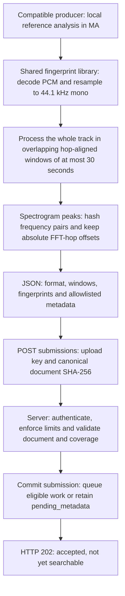
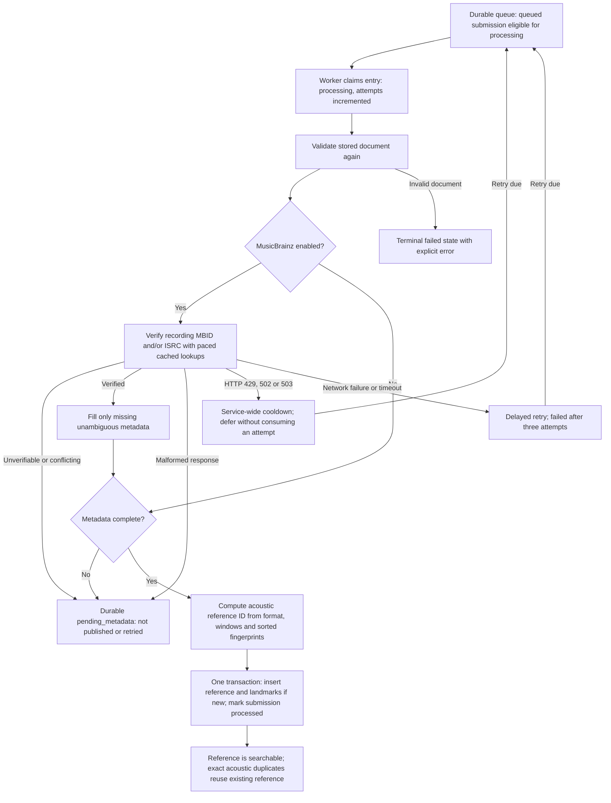
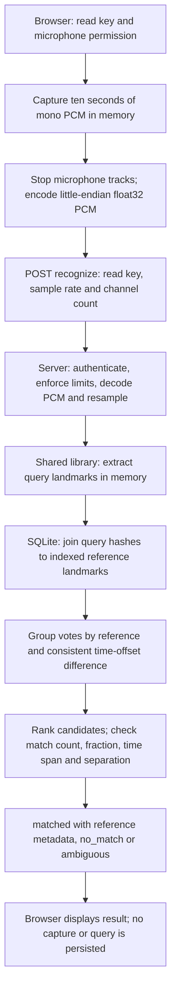
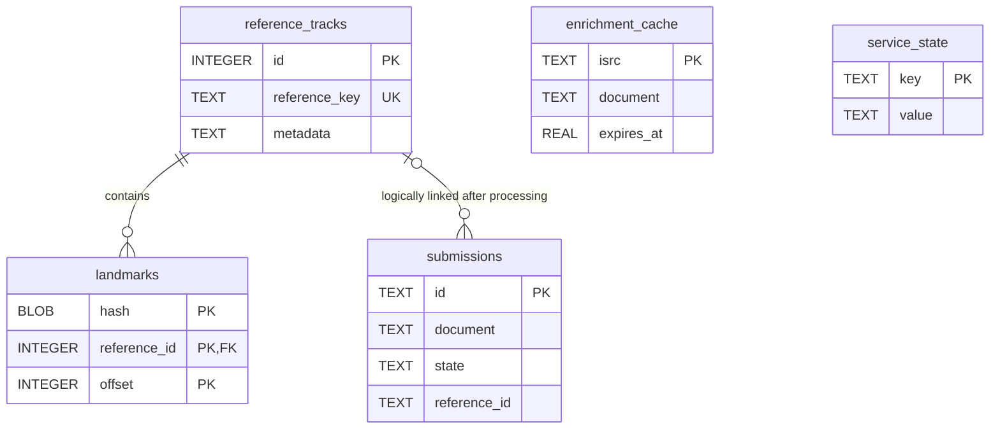
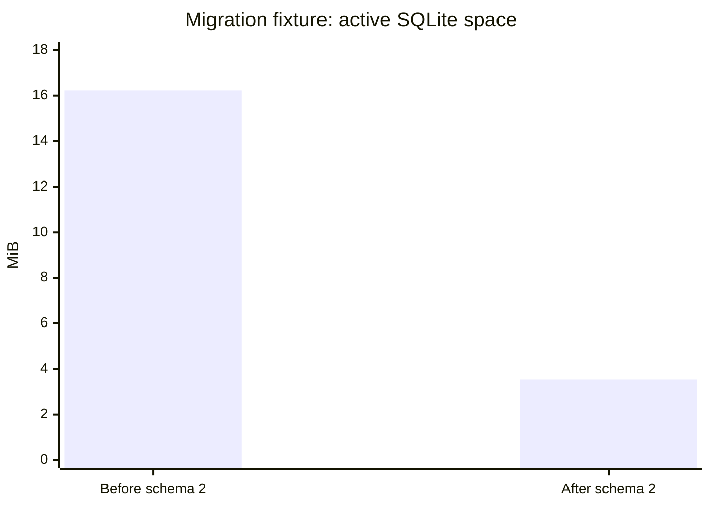
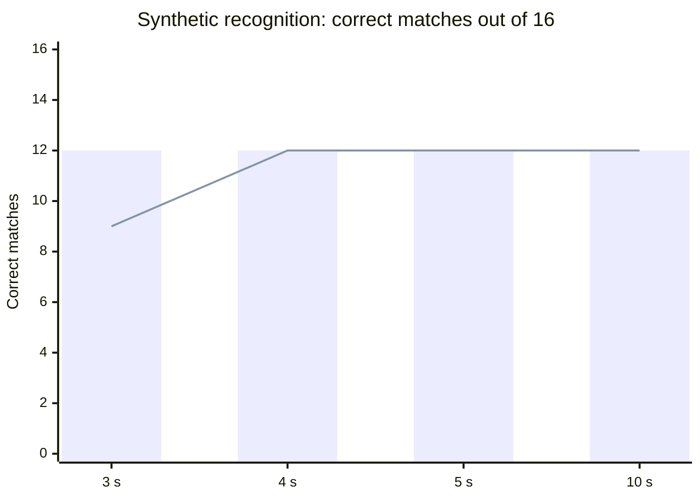
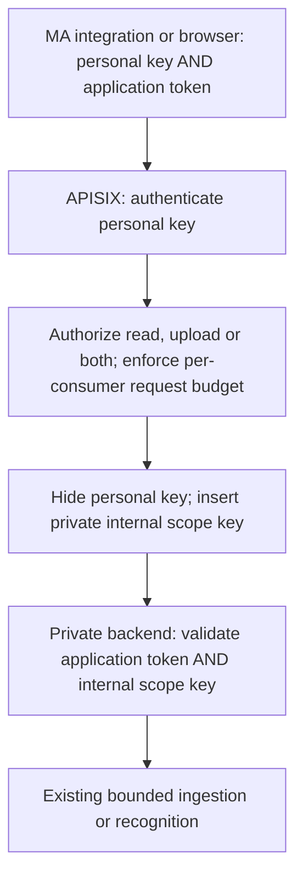

# Audio Fingerprint Server

An independent experimental service compatible with Music Assistant fingerprint submissions. This is not an official Music Assistant or Open Home Foundation (OHF) project, and no endorsement or adoption is implied. Future integration would require agreement with the respective maintainers. Music Assistant names below describe compatibility, not ownership. The shared library uses the neutral distribution name `audio-fingerprint` and Python import `audio_fingerprint`; stored fingerprint format IDs and this server's deployment directory remain unchanged for compatibility.

Licensed under [MIT](LICENSE). The shared library is available at [dmoo500/audio-fingerprint](https://github.com/dmoo500/audio-fingerprint). Its exact Git revision is pinned because there is no PyPI release.

The old analysis server is not modified. It accepts the MA `dejavu_analysis` provider's full-track `ma-dejavu-landmarks-v2` fingerprints and legacy sampled `ma-dejavu-landmarks-v1` documents, durably queues them and publishes validated references atomically. A local microphone page tests recognition against those references. No original provider audio is requested or stored; microphone PCM is processed in memory and discarded.

## How it works

There are two separate paths: contributors build the reference collection by submitting fingerprints; listeners query that collection with a short microphone capture. Recognition does **not** add the microphone recording to the collection or learn an unknown song. The server does not crawl a music catalogue or fetch reference audio itself.

### 1. Read reference audio and submit fingerprints

Reference extraction happens on the producer side, not in this server. The compatible MA analysis integration must be installed and sharing enabled; this project does not install that integration into MA.



The shared `audio-fingerprint` library implements window sampling and landmark extraction. A landmark is a frequency-pair hash plus a time offset, not an audio file or a title-based identifier. New v2 windows cover the entire decoded track; their approximately ten-second overlap protects context at section boundaries. Old v1 references still have unsampled gaps. Existing private analyses are not automatically uploaded. Repeated identical documents reuse their submission ID; already processed ones return HTTP 200 instead of adding queue work.

### 2. Process the queue and publish a reference



The submission ID covers the **whole document**, including metadata. The reference ID covers the **acoustic content and coverage**, excluding metadata. Multiple submissions can therefore point to one reference, and a later duplicate does not overwrite the first published complete metadata. An exact acoustic duplicate with complete metadata can make an excluded legacy reference searchable, without deleting its landmarks or original submission. Compact and legacy encodings of the same canonical document share an ID. Different acoustic formats or sampled passages are not automatically merged into one song.

Publication requires a nonblank title, at least one nonblank artist, a nonblank album, a positive finite duration, and either a valid ISRC or a recording UUID. Whitespace is checked but supplied metadata is not trimmed or rewritten. With MusicBrainz disabled, incomplete documents remain `pending_metadata`; with it enabled, documents with an identifier are checked before completeness and missing fields can be filled from an unambiguous result. An unresolved identifier, conflicting identifiers or missing required metadata remains pending with a reason and is not published. A missing duration defers the exact track-end coverage check, but window, offset, duration and upload limits still apply; duration is not inferred from MusicBrainz. To correct metadata, submit a corrected document; its whole-document submission ID is different and the original document remains retained.

Publishing is atomic: recognition cannot see a half-inserted reference. On startup, interrupted `processing` entries return to `queued`. An unexpected worker crash is reported and makes the health check fail rather than pretending ingestion still works.

### 3. Recognize a microphone capture



For each matching hash, the matcher subtracts the query offset from the reference offset. Many distinct landmarks agreeing on that difference support the same alignment within a track. The server performs this database lookup and ranking; the shared library only supplies the acoustic extraction. Weak or insufficiently separated candidates do not produce a match. Invalid input, overload and excessive candidate counts return explicit HTTP errors, not `no_match`.

Only indexed passages can contribute matching landmarks. MusicBrainz enrichment adds metadata, not fingerprints, and cannot make an unindexed song recognizable.

## Database tables

This is a recognition index with a durable ingestion queue, not a full music-library database. It does not maintain separate artist, album, user, audio-file or recognition history tables. Much of the structured input is retained as JSON:

| Persistent table | Contents | Purpose |
| --- | --- | --- |
| `submissions` | Legacy or compact JSON, queue state, attempts, retry time, error and published reference ID | Durable processing, duplicate upload handling and status; JSON includes analysis windows and supplied metadata |
| `reference_tracks` | Internal integer ID, public acoustic reference key, metadata JSON, creation time, publication readiness and verification version | Searchable references and retained references withheld pending metadata or identifier verification |
| `landmarks` | Ten-byte binary hash, internal reference ID and absolute offset in FFT hops | Compact searchable acoustic index; potentially many rows per reference |
| `enrichment_cache` | Versioned endpoint and identifier key, lookup result JSON and expiry | Cache successful, empty and ambiguous MusicBrainz results; normally empty when enrichment is disabled |
| `service_state` | Configuration transition markers | Keep enable and disable transitions durable and idempotent |



Only `landmarks.reference_id` has a database-enforced foreign key; the submission link is set by the worker and retains the public acoustic key, not the internal integer ID. The landmark primary key is the combination of hash, reference and offset. Its `WITHOUT ROWID` table stores that key once, and its hash-first order supports recognition lookups. The lookup keeps the small query table before the landmark table in the join order, avoiding a scan of the entire reference collection. Hashes are stored losslessly as ten bytes rather than twenty hexadecimal characters; upload documents and API reference IDs remain unchanged. Queue selection has an additional index on state, retry time and creation time.

Recognition creates a connection-local temporary `query` table for the hash join; it is not persistent and disappears when the connection closes. Coverage statistics are derived from submitted windows and reference duration rather than stored in another table. SQLite WAL/SHM files are database support files, not tables. Table count therefore says little about collection size: count references and landmark rows separately. There is no automatic pruning of processed submissions or references in this pilot.

## Benchmark results and shipped optimizations

These are local prototype measurements, not performance guarantees or recognition rates for a music catalogue. Storage, document size, extraction time and recognition accuracy measure different things and must not be combined into a single improvement percentage. Historical optimization measurements below were collected during development; the short-capture experiment was run on 2026-11-15.

### Database storage

Schema 2 replaced hexadecimal TEXT hashes with ten-byte BLOBs, introduced internal integer reference IDs and used a `WITHOUT ROWID` landmark table. Public reference keys, acoustic hashes and offsets were preserved. The query-first indexed join avoided the full landmark scan seen in the initial compact-layout experiment.

| Measurement | Before | After | Interpretation |
| --- | ---: | ---: | --- |
| Generated v2 migration fixture, 71,954 landmarks: active SQLite pages | 16.23 MiB | 3.54 MiB | About 78% less active space for this fixture |
| Deployed database after schema 2 migration: physical file | Not a controlled comparison | 4,502.23 MiB | File still includes reusable pages; no `VACUUM` performed |
| Same deployed database: active / reusable space | Not a controlled comparison | 893.57 / 3,608.66 MiB | Freed pages can be reused without shrinking the file |



The deployed snapshot contained 274 references. It is a historical snapshot, not the current database size or a projection per song. An earlier upper-limit synthetic baseline with 36 MB JSON and one million landmarks occupied about 238.3 MiB; it was not a before/after measurement of the deployed collection. Schema 3 subsequently compacted stored submission documents; no isolated schema 3 space-saving percentage was measured. Transactional upgrades, pre-upgrade backups including WAL data, and rejection of unsupported layouts are shipped safeguards, not speed or size improvements. None of these upgrades resets the collection.

### Library extraction and document encoding

The shipped library 0.3.0 preserves the landmark algorithm while reducing Python scalar-conversion overhead and adding the lossless `sha1-80-offset-delta-v1` codec. The server accepts both compact and legacy documents with the same canonical identity. Earlier shipped extraction changes process FFTs in 64-frame batches with the peak-filter halo and avoid retaining a full-window spectrogram. Streaming reference analysis keeps a bounded rolling PCM window. These memory bounds preserve exact hashes and offsets; no measured peak-memory reduction is reported here.

| Measurement | Result | Scope |
| --- | --- | --- |
| Extraction, 30-second noise fixture | 69.662 to 67.110 ms; about 3.66% less time | Alternating local comparison, 30 runs |
| Extraction, 30-second silence-gap fixture | 58.322 to 57.122 ms; about 2.06% less time | Same comparison method |
| Extraction, 30-second tone fixture | 46.348 to 46.312 ms | No meaningful improvement |
| Production compact landmark JSON section | About 49-50% smaller | 60-second synthetic noise/tone fixtures; includes base64 and encoding field, excludes the rest of the document |
| Compact encoding / decoding | About 42 / 21 ms median | 23,986 noise landmarks; additional codec work, not total upload latency |

Earlier representation experiments found approximately 53% savings for ten-byte hashes with fixed-width offsets and 63% for delta-varint offsets **before base64**, relative to canonical JSON pairs. Adding zlib to the delta representation reached approximately 64%; JSON with zlib reached approximately 49%. These used synthetic v2 documents and three existing processed v1 reference documents, not a representative catalogue. Fixed-width encoding and zlib remain experiments, not production formats. The raw 63% saving must not be presented as the JSON/API saving. See the [library benchmark documentation](https://github.com/dmoo500/audio-fingerprint#lossless-optimization-benchmarks) for repeatable compression commands and compatibility details.

### Short-capture recognition

The experiment used the unchanged production HTTP extraction, matching and acceptance path with an isolated database: library revision `cbfa2fc`, server revision `d17387f`, minimum 30 matches and minimum match fraction 0.02. No live collection, credentials or stored audio were used or changed.

Four independent 30-second synthetic references were indexed: two changing harmonic/percussive signals (seeds 101 and 202) and two white-noise signals (303 and 404). Each query began at 2.137, 7.431, 13.819 or 17.203 seconds, without snapping to FFT hops. For each duration/noise condition there were 16 known-reference queries and three controls: an unknown harmonic signal (505), unknown noise (606) and silence. White noise was added at a measured RMS signal-to-noise ratio (SNR), with deterministic seed `912 + start_sample`; peaks above 0.95 were uniformly scaled before float32 encoding.

| Capture duration | Clean | 20 dB SNR | 10 dB SNR | 0 dB SNR |
| --- | ---: | ---: | ---: | ---: |
| 1 second | HTTP 422 | HTTP 422 | HTTP 422 | HTTP 422 |
| 2 seconds | HTTP 422 | HTTP 422 | HTTP 422 | HTTP 422 |
| 3 seconds | 12/16 | 12/16 | 9/16 | 1/16 |
| 4 seconds | 12/16 | 12/16 | 12/16 | 2/16 |
| 5 seconds | 12/16 | 12/16 | 12/16 | 1/16 |
| 10 seconds | 12/16 | 12/16 | 12/16 | 0/16 |

Entries are correct title-and-position matches, not just returned candidates. Position was checked within two FFT hops of the known start. Bars below show clean queries; the line shows 10 dB SNR queries. The table also retains the stronger-noise results.



Across 456 requests, 152 were rejected because the API requires at least three seconds. Of 256 supported known-reference queries, 145 matched correctly and 111 returned `no_match`; there were no wrong-title, wrong-position or ambiguous results. All 48 supported unknown/silence controls returned `no_match`. Each isolated duration/noise cohort remained below the unchanged request-rate limit. Clean harmonic/percussive queries matched at all eight positions even at three seconds; the four clean failures per duration came from the white-noise references.

Local median HTTP processing time, excluding capture time, real networking and gateway overhead, was approximately 9-10 ms at three seconds, 13-14 ms at four seconds, 16 ms at five seconds and 30-31 ms at ten seconds. These timings use a tiny collection and do not predict deployed lookup latency.

The synthetic results support testing 3-5-second clean line-in captures, but do not establish real line-in or microphone accuracy. Additive noise does not model room reverberation, speaker response or microphone processing. Ten seconds did not reliably overcome strong noise, and longer captures did not monotonically improve results. One- and two-second recognition quality was not measured because the API rejected them. The browser still captures ten seconds; no capture duration or threshold was changed.

### Validation snapshots

The published codec work was validated with 79 passing library tests, 139 passing receiver tests plus one skipped opt-in test, and 100 passing focused MA tests. Coverage included exact codec round trips and canonical identity, decoded limits, legacy compatibility, transactional migrations and WAL-aware backups, HTTP ingestion and recognition, and MA upload consent. These are historical run counts, not the current suite size. The full MA pre-commit mypy hook was blocked by existing Hue/Deezer typing errors; focused checks passed and the commit skipped only that hook with explicit approval. No full-repository type-check success is claimed.

The later MA metadata-repair work had 194 passing focused tests but is not part of the pushed optimization revisions summarized here. The short-capture benchmark is a separate experiment, not a production capture-duration change.

## Local setup

Clone using the technical directory name expected by the Docker build:

```sh
git clone https://github.com/dmoo500/audio-fingerprint-server.git music-assistant-fingerprint-server
cd music-assistant-fingerprint-server
uv venv --python 3.14
uv pip install -e '.[dev]'
export FP_UPLOAD_KEY="$(uv run --no-sync python -c 'import secrets; print(secrets.token_urlsafe(32))')"
export FP_READ_KEY="$(uv run --no-sync python -c 'import secrets; print(secrets.token_urlsafe(32))')"
uv run --no-sync uvicorn fingerprint_server.app:app --host 127.0.0.1 --port 8097 --workers 1
```

Keep these keys privately for your session. Set the MA provider's URL to `http://localhost:8097` and its API key to `FP_UPLOAD_KEY` when MA runs on the same machine. MA in another container needs a reachable HTTPS destination; localhost there means that container, not this host. Do not relax the MA provider's HTTP guard.

Open <http://localhost:8097>, enter the **read** key and allow microphone access. The page records exactly ten seconds after you press the button, stops microphone access and sends normalized mono float32 PCM to this server. It does not keep the key in browser storage. The upload key is never distributed with the website.

Enable sharing in MA **before** analyzing reference tracks. Old private analyses are not backfilled. The reference database must contain the song and the captured passage must overlap indexed audio. New full-track references have no sampling gaps; legacy references remain only partially covered.

## Docker

The build context is the parent directory; use the clone directory name shown above. Only this project's source is copied into the image; the shared library is installed from its pinned public Git revision. From this directory, set both private key environment variables and run `docker compose up --build`. The named volume holds the durable queue and references. The web port is bound only to loopback. Use an authenticated HTTPS deployment and review operational limits before exposing the service publicly. Microphone access on non-localhost sites requires HTTPS.

This first implementation uses SQLite/WAL and **one application process**. Do not scale it to multiple workers/replicas: queue recovery, request throttling and the ingestion worker are single-process. PostgreSQL and distributed workers are not included. Never delete the volume during upgrades; back up the SQLite database with SQLite's backup API (or with the service stopped), not by copying a live database without its WAL. Startup upgrades recognized older databases before starting the worker or serving requests; see the version and recovery policy below. Incomplete historical references remain excluded from recognition and their formerly processed uploads become `pending_metadata`. Malformed historical coverage is counted as partial for otherwise complete references.

Never run two receiver workers against the same database. Keep credentials, collection backups and machine-specific Compose overrides outside version control. If MA already binds port 8097, use a local override for the gateway's published port; do not publish the backend.

### Database upgrades and version policy

Four independent versions describe different contracts:

| Version | Current value | When it changes |
| --- | --- | --- |
| Database schema (`PRAGMA user_version`, `DB_SCHEMA_VERSION`) | 4 | Stored layout or document encoding needs a migration |
| HTTP API major version | `/api/v1` | An incompatible request/response contract requires a new API major version |
| Fingerprint format (`format_id`) | v1 and v2 supported | Acoustic parameters or coverage semantics change |
| Landmark encoding (`fingerprints_encoding`) | `sha1-80-offset-delta-v1` or legacy JSON | Lossless landmark representation changes |

DB version 0 denotes the original unversioned databases, with or without the publication-readiness column. Migration 1 completes the publication gate. Migration 2 converts hashes to binary storage and assigns internal integer reference IDs. Public reference keys, submission IDs, decoded documents, metadata, offsets, cache entries and publication decisions are retained. This is a storage change, not a fingerprint algorithm or HTTP API change; producers need no update or reanalysis. Migration 3 compacts existing valid canonical submission documents using the shared codec. Invalid or noncanonical records are logged and retained unchanged; migration never invents replacement IDs. Migration 4 records verification versions and configuration transitions; new installations create schema 4 directly.

Before upgrading an existing database, startup creates a consistent SQLite backup beside it named `<database>.pre-v<old-version>-<timestamp>.bak` and logs its path. The backup includes committed WAL data, is private to the file owner and is not automatically deleted. Allow space for this full backup, the replacement tables and the migration WAL. Large collections can take time to upgrade; do not start a second server process. All migration steps and version changes commit together. A failed migration rolls back and stops startup with an error instead of resetting the collection. Invalid hashes, orphaned landmarks, unknown layouts and newer unsupported schema versions are refused rather than discarded or guessed.

The compact tables use fewer active pages, but SQLite reuses freed pages rather than automatically shrinking the file. Optional file compaction with SQLite `VACUUM` should be scheduled separately while the service is stopped, after a backup and with enough temporary disk space. Startup does not run `VACUUM`.

For a downgrade, stop the service and restore the pre-upgrade backup using SQLite's backup tooling before starting the older executable. Do not run old code against the compact schema or copy over a database while its WAL/SHM files are still in use. A restore loses uploads accepted after that backup; retain the upgraded database separately if those later uploads need recovery.

Future DB changes add ordered migrations and increase `DB_SCHEMA_VERSION`; unsupported newer versions must continue to stop startup. A storage-only change does not bump the API. An incompatible API change needs a new route version and coordinated producer support. A new acoustic format needs an explicit `format_id`, receiver support before producers enable it, and a compatibility decision; a DB migration never relabels old fingerprints.

## API

All mutation/status calls require the upload key; recognition requires the read key in `X-API-Key` in legacy mode. In the optional gateway mode, every protected request instead carries a personal key in `X-API-Key` **and** the fingerprint application's token in `X-Application-Key`. Keys must differ and each contain at least 24 characters.

- `POST /api/v1/dejavu/submissions`: v2 JSON document, max 36,000,000 bytes and
  1,000,000 landmarks, up to 30 minutes of complete coverage. Legacy v1 documents
  retain their 2,000,000-byte / 100,000-landmark / three-window limits.
  Legacy pairs and compact `sha1-80-offset-delta-v1` documents are accepted.
  Size limits apply to the upload and decoded canonical document, so packing does not
  bypass limits. `Idempotency-Key` is the SHA-256 of **decoded canonical JSON**, without
  `fingerprints_encoding` (`sort_keys=True`, compact separators, Python's default ASCII
  escaping). HTTP 202 returns the durable state (`queued`,
  `processing` or `pending_metadata`), not a publication acknowledgement.
  HTTP 200 `processed` acknowledges an already published duplicate.
- `GET /api/v1/dejavu/submissions/{id}`: processing state, attempts, explicit failure
  and published reference ID. A terminally failed repeated submission returns HTTP 409.
- `GET /api/v1/dejavu/capabilities`: upload-authenticated supported API major,
  acoustic formats, landmark encodings and document-size limit. Deploy the updated receiver
  and reconfigure gateway routes before updating the producer to library 0.3.0.
  This compatible addition keeps `/api/v1`; an old receiver is explicitly rejected by
  the compact producer, not silently treated as supporting the codec.
- `POST /api/v1/dejavu/recognize?sample_rate=48000&channels=1`:
  `application/octet-stream`, little-endian float32 PCM, 3 to 15 seconds,
  8 to 192 kHz, one or two channels. No audio file/container decoding.
  Returns `matched`, `no_match` or `ambiguous`; `match` is null unless matched.
- `GET /health`: 503 if the ingestion worker has stopped.
- `GET /api/v1/dejavu/statistics`: read-key authenticated counts of indexed acoustic
  references (searchable total, partially covered, fully covered, and separately excluded
  legacy references), uploads by queue state including `pending_metadata`, and worker status.
  The microphone page refreshes these every 15 seconds while visible after entering the read key.
  Failed requests clear the displayed counts instead of presenting stale data as current.

Coverage is computed from stored windows rather than a separate stored coverage flag. Full coverage means the union of windows starts at zero, has no gaps and reaches the exact track duration in samples; even small unsampled gaps count as partial. This describes sampled audio, not guaranteed recognition of every passage. New v2 references have full coverage; legacy references usually have partial coverage because only three windows were analyzed. Different acoustic references for the same song can count as different tracks; duplicate uploads of an identical reference count once. Queue counts describe submissions, not tracks or analyses still running inside MA before upload.

Reference hashes and offsets are validated against hop-aligned coverage. V2 requires complete coverage and permits overlap; legacy v1 windows must not overlap. Only the worker can publish them. Exact acoustic submissions deduplicate even when metadata differs; original supplied metadata is retained rather than overwritten by a later conflicting contribution. Acoustic deduplication here means identical landmarks/coverage, **not** merging all different encodings or partial recordings. An excluded reference can receive complete supplied metadata from an exact duplicate; already complete reference metadata is never overwritten.

Submissions are limited to 60/minute; recognition and status reads use their respective credential scopes (30 read requests/minute). Two recognition computations can run at once. Statistics have a separate 30 requests/minute budget, so refreshes do not consume recognition requests. Repetitive queries with excessive candidate counts fail explicitly rather than returning a misleading match. The queue is bounded by submission count and by 256,000,000 bytes of queued, processing and pending-metadata stored JSON (`FP_QUEUE_BYTES_LIMIT`); full queues return 503 with Retry-After. This is a private pilot, not a hardened anonymous public contribution service.

### Upgrade from sampled references

Deploy this receiver before enabling the full-track MA provider or updating its local fingerprint library to 0.2.2. The provider increments its analysis version to 2, making old analyses eligible for replacement on the next normal full playback or an existing filesystem-only scan. It does not fetch streaming-provider audio for backfill, redirect old uploads, or retroactively upload private analyses.

Existing server references and pending v1 submissions remain valid and are not deleted. The current storage upgrade preserves them without changing their fingerprint format. They do not become fully covered just by upgrading. Statistics count acoustic references, so one recording can have an old partial and a new full reference. Matching groups strongly overlapping, equally aligned references with identical nonempty identifying metadata to avoid treating old/new copies as competing answers; conflicting metadata and different alignments remain distinct.

Full analysis costs more CPU and storage than sparse sampling. MA uses its existing low-priority bounded analysis pool and playback-active serialization; overloaded analysis can be cancelled rather than reported as complete. There is no guarantee of zero performance impact. The rolling PCM buffer is bounded, but returned fingerprints accumulate until publication. Validate latency and memory on the target hardware before enabling many simultaneous analyses.

## API keys and future administration

**Default / legacy mode:** two shared secrets supplied through environment variables, with no API-key database or admin UI in the fingerprint server.

| Key | Access |
| --- | --- |
| `FP_UPLOAD_KEY` | Submit references and read submission status |
| `FP_READ_KEY` | Recognize PCM and read collection statistics |

In this default mode there are no individual accounts, per-contributor credentials, expiry dates or individual revocation. Rotation requires changing the configured secret and restarting the service; all clients using that secret must be updated. Request budgets are shared per scope within the process, not assigned to individual users. The browser keeps its read key only in the current page, but anyone holding that key has its full permissions. There is no public self-service key issuance.

### Optional APISIX mode: application token AND personal token

This deployment uses [Apache APISIX](https://apisix.apache.org/) for administratively issued personal keys. It is opt-in; the existing local setup and `compose.yaml` remain unchanged. There is no self-service developer portal, user login or automatic expiry. The application token is a separate fingerprint-service credential, **never** a login token from a local MA instance and not an officially issued Music Assistant credential. This pilot supports one configured application token.



APISIX checks the personal key; the server checks the client-supplied application token using a constant-time comparison. The gateway does not manufacture or substitute the application token. It replaces `X-API-Key` with the internal read/upload key only after personal-key authentication. An application token alone, a personal key alone, or forged consumer headers cannot grant API access. The backend ignores consumer headers for permissions; APISIX uses its authenticated consumer context for permissions and limits. The verified consumer username is forwarded only for audit logging.

Personal credentials and gateway configuration live in APISIX's separate etcd volume, not the fingerprint database. No fingerprint schema migration is needed. `FP_UPLOAD_KEY` and `FP_READ_KEY` become private gateway-to-backend secrets and must not be issued to participants. Shared application tokens embedded in distributed software can be extracted; they identify an application convention, not prove its authenticity or act as a second factor for a user. Personal keys remain the individual revocable access credential.

#### Start and configure

Use the same Compose project/directory as the existing deployment to retain its `fingerprints` volume. **Do not combine the two Compose files**: the gateway file is a complete alternative, with no published backend port. A differently named Compose project selects a different volume and does not migrate your collection automatically. Native runs using `data/fingerprints.db` still require a deliberate database transfer before switching to Docker; do not copy a live WAL database.

Set the existing internal keys and generate two additional independent secrets:

```sh
export FP_GATEWAY_ENABLED=true
export FP_APPLICATION_KEY="$(uv run --no-sync python -c 'import secrets; print(secrets.token_urlsafe(32))')"
export FP_GATEWAY_ADMIN_KEY="$(uv run --no-sync python -c 'import secrets; print(secrets.token_urlsafe(32))')"
# FP_UPLOAD_KEY and FP_READ_KEY must also be exported for the provisioning command.
docker compose -f compose.yaml stop fingerprints
docker compose -f compose.gateway.yaml up --build -d
uv run --no-sync python -m fingerprint_server.gateway configure
```

Wait for APISIX to start before running `configure`; failures are reported and the command can be repeated. It updates the managed routes and role groups, preserving personal keys. Until routes are configured, the gateway has no public catch-all route to the backend. The gateway proxy is at `http://localhost:8097`; its Admin API is bound to loopback port 9180. The etcd service has no host port. Keep Admin API access private and never give its key to a developer or browser. The loopback proxy needs an HTTPS front end before remote use; microphone access also requires HTTPS outside localhost.

#### Issue, rotate and revoke personal keys

The commands use the local Admin API and require `FP_GATEWAY_ADMIN_KEY` in the environment:

```sh
uv run --no-sync python -m fingerprint_server.gateway issue my-ma-installation --role both
uv run --no-sync python -m fingerprint_server.gateway issue microphone-test --role read
uv run --no-sync python -m fingerprint_server.gateway revoke microphone-test
```

`issue` prints the newly generated personal key for private delivery to its recipient. Roles are `read` (recognition/statistics), `upload` (submissions/status) and `both`. Issuing again for an existing name **replaces its key and role**, invalidating the previous key after the gateway observes the configuration update. Revocation removes that consumer; other consumers remain unaffected. Store generated keys securely; do not paste them into issue reports or shared logs. Administration errors return a nonzero exit status.

Clients send both headers on every protected request:

```http
X-API-Key: <personal-fingerprint-key>
X-Application-Key: <fingerprint-application-token>
```

The microphone page has separate inputs for both keys and stores neither in browser storage. The experimental Dejavu MA provider resolves its application token using MA's shared `app_var("dejavu_application_key")` mechanism, like Apple Music, with an optional secure **Application token override** for a specific server. For this independent pilot there is no official bundled token: supply it locally through `MASS_APP_VAR_DEJAVU_APPLICATION_KEY` or the secure override field. Enter a personal key with `upload` or `both` permission in **Upload API key**. If no application token is supplied, the provider retains legacy behavior. This repository does not install the MA provider. Normal and recovered uploads use the same headers; the provider does not poll processing status. Other clients that poll status must send both headers there too. There is deliberately no one-key fallback once gateway mode is enabled.

Each consumer has route-specific budgets: 60 submissions/minute, 60 status reads/minute, 30 recognition requests/minute and 30 statistics reads/minute. These gateway counters are local to one gateway instance. Existing backend-wide limits and recognition concurrency still apply, so per-consumer budgets do not increase overall service capacity. Multiple gateway replicas would need shared counter storage; the backend remains single-process.

#### Storage, rotation and rollback

Back up both the fingerprint collection and the etcd credential/configuration store using their respective supported backup mechanisms. The etcd volume contains personal keys and internal upstream secrets; treat it as sensitive.

Gateway Docker logs show method, path and response status. Backend logs record successful authentication with the verified consumer ID, scope and the application's stable `fingerprint` label. This pilot has one configured application token, not a multi-application registry. Public and rejected requests do not establish an application identity; legacy shared-key mode has no individual user/application IDs. No API keys, key fingerprints, credential headers, query strings or request bodies are included in the audit format. Do not put credentials in URLs.

Use the logged consumer ID with `gateway revoke <consumer-id>` to block that user; other users are unaffected. Blocking the single application requires rotating its configured token and recreating the backend. Protect and rotate logs too: consumer IDs are operational identifiers, not anonymous data.

Changing an internal read/upload secret requires recreating the backend with its new environment **and** rerunning `configure` to update gateway routes. Changing the application token requires recreating the backend and updating clients. Changing the Admin API key requires recreating the gateway and updating the operator environment. During a mismatched rotation, requests fail rather than fall back to legacy access.

To return to the previous deployment without deleting either volume:

```sh
docker compose -f compose.gateway.yaml down
unset FP_GATEWAY_ENABLED FP_APPLICATION_KEY
docker compose -f compose.yaml up --build -d
```

Legacy clients then use the original read/upload keys again. Never use `down -v` for this deployment or rollback: it removes the collection and credential volumes.

## Optional metadata enrichment

Set `FP_MUSICBRAINZ_ENABLED=true` and `FP_MUSICBRAINZ_CONTACT` to a suitable contact. `FP_MUSICBRAINZ_BASE_URL` defaults to `https://musicbrainz.org/ws/2`; set it to another MusicBrainz-compatible API base for a self-hosted instance, including any path prefix:

```sh
export FP_MUSICBRAINZ_ENABLED=true
export FP_MUSICBRAINZ_CONTACT="operator@example.org"
export FP_MUSICBRAINZ_BASE_URL="https://metadata.example.org/musicbrainz/ws/2"
```

The worker uses `/recording/{mbid}?inc=artists+isrcs+releases&fmt=json` and `/isrc/{isrc}?inc=artists+releases&fmt=json`. HTTP is supported for explicitly configured local instances; use HTTPS for remote endpoints. Embedded credentials, query strings and fragments in the base URL are rejected. Both Compose modes pass these settings through; recreate the service after changing them. Inside a container, `localhost` refers to that container, so use a hostname reachable from the backend. Cache keys include the API endpoint and response version, so older cache entries and results from a different endpoint are not reused.

The worker validates supplied recording MBIDs and ISRCs, checking their relationship when both are supplied; it does not guess recordings from song titles. Redirects are withheld rather than assumed valid. Lookups are paced at least 1.1 seconds apart and cached for seven days, including empty and ambiguous results; outages are not cached. HTTP 429, 502 and 503 pause the whole worker and defer the current submission without consuming an attempt, using exponential backoff from 30 seconds up to 15 minutes or a longer `Retry-After` delay. Other HTTP and network failures retain the three-attempt retry limit. Only missing metadata is filled, and an album is filled only when the returned release list is complete and has one distinct title. Ambiguity, conflicts, malformed responses and missing fields remain pending with an explicit reason. MusicBrainz validates identifiers and metadata, not that submitted fingerprints match the recording or that the audio is authentic.

The shared cooldown is held in memory and resets on restart, but the current submission's delayed retry remains in the queue. Even submissions that could use cached results wait for the cooldown before being claimed. Logs distinguish service-wide cooldowns from per-submission failures; submissions already marked failed by older versions are not automatically requeued.

Enabling verification upgrades the database with a private pre-upgrade SQLite backup, withholds existing unverified references from recognition and statistics, and requeues eligible existing submissions once. References and landmarks are retained; successfully verified references become searchable again, while unresolved submissions remain pending. A reference with no usable identifier or submission cannot be automatically verified. Disabling verification restores the offline completeness gate; re-enabling retains successful verification and queues newly unverified references rather than reprocessing the entire collection. Verification is disabled by default.

## Validation and limitations

```sh
uv run --no-sync pytest -q
uv run --no-sync ruff check .
uv run --no-sync ruff format --check .
uv run --no-sync mypy fingerprint_server
node --test tests/test_microphone.js
# Optional: real gateway test with isolated containers, fresh volumes and local ports.
FP_RUN_GATEWAY_TESTS=1 uv run --no-sync pytest -q tests/test_gateway_integration.py
```

The offset-voting matcher reports distinct aligned landmarks, their fraction and matched time span, **not a calibrated probability**. Thresholds are initial conservative defaults, not measured real-microphone accuracy. Test room noise, resampling, capture phase, different masterings and ambiguous references before relying on it. Compatibility with other Dejavu versions/databases is not established.

The local browser worklet/HTTP path has been tested with a synthetic reference and a simulated microphone stream, including automatic track shutdown. This does not validate real acoustic recording quality. The opt-in Docker test builds the service and exercises the real APISIX gateway with isolated volumes: both credentials, role restrictions, PCM recognition, revocation, per-consumer limits and an unpublished backend port.

A later Sendspin/AUX integration should submit bounded incoming PCM to this same recognition endpoint and consume returned metadata. A safe generic live-PCM tap in MA still needs design; no Sendspin or player/queue internals are modified by this project.
