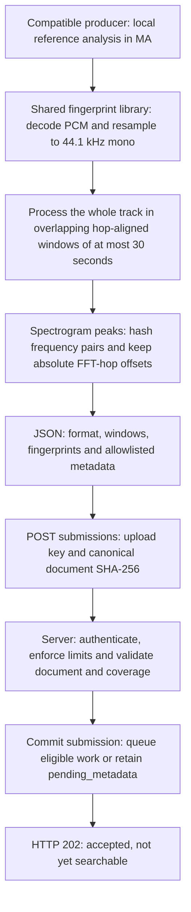
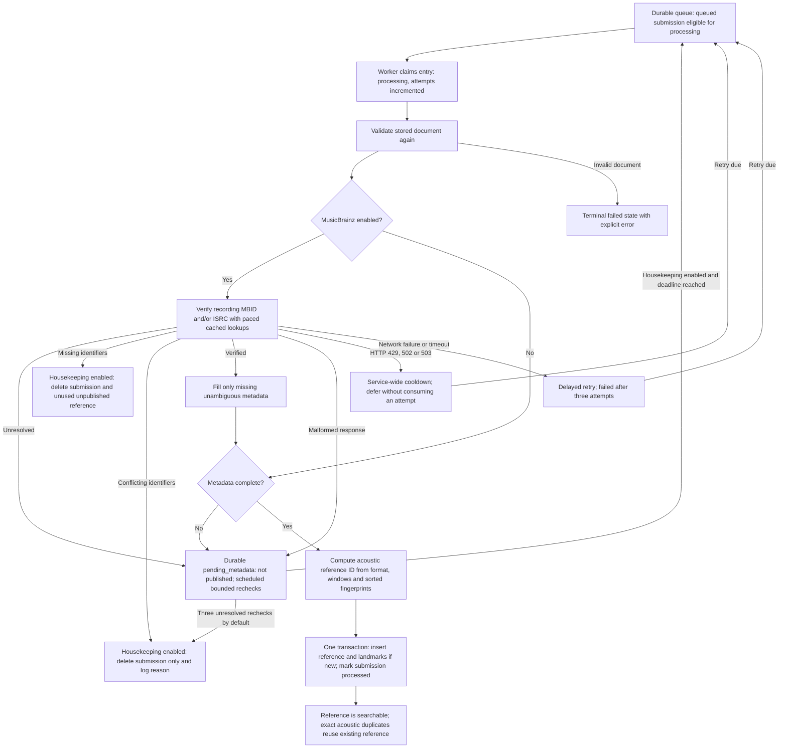
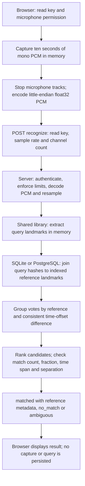
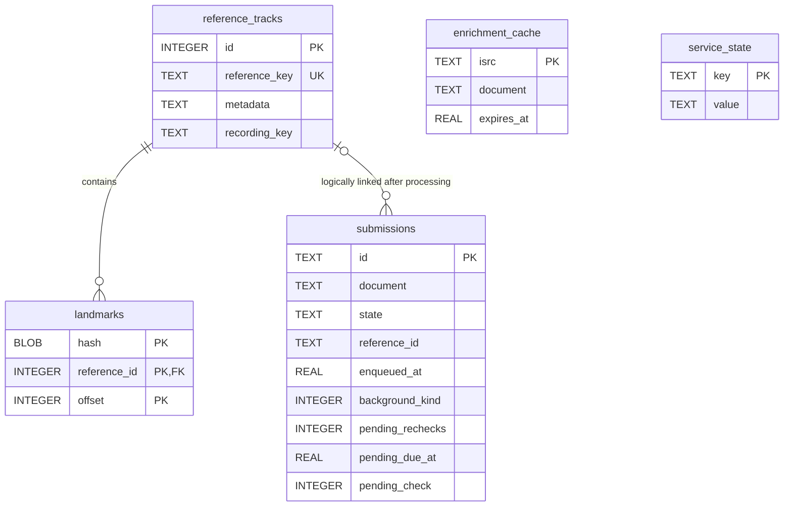

# Architecture and data flow

[Home](../README.md) · [Documentation](README.md)

## How it works

There are two separate paths: contributors build the reference collection by submitting fingerprints; listeners query that collection with a short microphone capture. Recognition does **not** add the microphone recording to the collection or learn an unknown song. The server does not crawl a music catalogue or fetch reference audio itself.

### 1. Read reference audio and submit fingerprints

Reference extraction happens on the producer side, not in this server. The compatible MA analysis integration must be installed and sharing enabled; this project does not install that integration into MA.

The shared `audio-fingerprint` library implements window sampling and landmark extraction. A landmark is a frequency-pair hash plus a time offset, not an audio file or a title-based identifier. New v2 windows cover the entire decoded track; their approximately ten-second overlap protects context at section boundaries. Old v1 references still have unsampled gaps. Existing private analyses are not automatically uploaded. Repeated identical documents reuse their submission ID; already processed ones return HTTP 200 instead of adding queue work.

### 2. Process the queue and publish a reference

The submission ID covers the **whole document**, including metadata. The reference ID covers the **acoustic content and coverage**, excluding metadata. Multiple submissions can therefore point to one reference, and a later duplicate does not overwrite the first published complete metadata. An exact acoustic duplicate with complete metadata can make an excluded legacy reference searchable, without deleting its landmarks or original submission. Compact and legacy encodings of the same canonical document share an ID. Different acoustic formats or sampled passages are not automatically merged into one song.

Publication requires a nonblank title, at least one nonblank artist, a nonblank album, a positive finite duration, and either a valid ISRC or a recording UUID. Whitespace is checked but supplied metadata is not trimmed or rewritten. With MusicBrainz disabled, incomplete documents remain `pending_metadata`; with it enabled, documents with an identifier are checked before completeness and missing fields can be filled from an unambiguous result. Unresolved identifiers and missing required metadata remain pending with a reason and are not published; enabled housekeeping retries or removes them according to the [housekeeping policy](metadata.md#pending-metadata-housekeeping), and removes definitively conflicting identifiers. A missing duration defers the exact track-end coverage check, but window, offset, duration and upload limits still apply; duration is not inferred from MusicBrainz. To correct metadata, submit a corrected document; its whole-document submission ID is different and the original document follows the housekeeping policy independently.

Publishing is atomic: recognition cannot see a half-inserted reference. On worker startup, interrupted queued work retains its FIFO position and background classification without spending a completed recheck. An interrupted manual pending check returns to `pending_metadata`. An unexpected worker crash is reported and makes the health check fail rather than pretending ingestion still works. SQLite runs API and worker together. PostgreSQL supports separate roles and [opt-in API replicas](operations/replicas.md) with shared request/concurrency budgets; ingestion ownership remains exclusive. PostgreSQL API startup never recovers another process's jobs. Multiple workers are always rejected.

### 3. Recognize a microphone capture

For each matching hash, the matcher subtracts the query offset from the reference offset. Many distinct landmarks agreeing on that difference support the same alignment within a track. The server performs this database lookup and ranking; the shared library only supplies the acoustic extraction. Weak or insufficiently separated candidates do not produce a match. Invalid input, overload and excessive candidate counts return explicit HTTP errors, not `no_match`.

Only indexed passages can contribute matching landmarks. MusicBrainz enrichment adds metadata, not fingerprints, and cannot make an unindexed song recognizable.

## Database tables

This is a recognition index with a durable ingestion queue, not a full music-library database. It does not maintain separate artist, album, user, audio-file or recognition history tables. Much of the structured input is retained as JSON:

| Persistent table | Contents | Purpose |
| --- | --- | --- |
| `submissions` | Legacy or compact JSON, queue state, attempts, retry time, error, published reference ID, FIFO admission time and background-check lifecycle | Durable processing, duplicate upload handling, bounded background admission and status; JSON includes analysis windows and supplied metadata |
| `reference_tracks` | Internal integer ID, public acoustic reference key, metadata JSON, creation time, publication readiness, verification version and optional verified recording key | Retained acoustic variants; verified recording keys group logical recordings without merging their fingerprints |
| `landmarks` | Ten-byte binary hash, internal reference ID and absolute offset in FFT hops | Compact searchable acoustic index; potentially many rows per reference |
| `enrichment_cache` | Versioned endpoint and identifier key, lookup result JSON and expiry | Cache successful, empty and ambiguous MusicBrainz results; normally empty when enrichment is disabled |
| `service_state` | Configuration transition markers | Keep enable and disable transitions durable and idempotent |

Only `landmarks.reference_id` has a database-enforced foreign key; the submission link is set by the worker and retains the public acoustic key, not the internal integer ID. The landmark primary key is the combination of hash, reference and offset. In SQLite, the `WITHOUT ROWID` table stores that key once, and the query explicitly keeps the small query table outermost. PostgreSQL uses a heap plus a hash-first B-tree primary key and its planner selects the join strategy. Both backends index landmarks by reference for deletion and store hashes losslessly as ten bytes rather than twenty hexadecimal characters; upload documents and API reference IDs remain unchanged. Queue selection has indexes for state and due work. PostgreSQL uses bigint internal reference IDs and an explicit `queue_order` identity in place of SQLite's rowid FIFO tie-breaker. Its additional `migration_info` table records PostgreSQL format 1 and importer source-version provenance; transient process tokens and heartbeats use `service_state`.

Recognition creates a connection-local temporary `query` table for the hash join; it is not persistent and disappears when the connection closes. Both backends use the same Python ranking, coverage and identifier-resolution decisions. Coverage statistics are derived from submitted windows and reference duration rather than stored in another table. SQLite WAL/SHM files are database support files, not tables. Table count therefore says little about collection size: count references and landmark rows separately. Processed submissions and published references are not automatically pruned; unused unpublished references can be removed only by the documented missing-identifier housekeeping.
