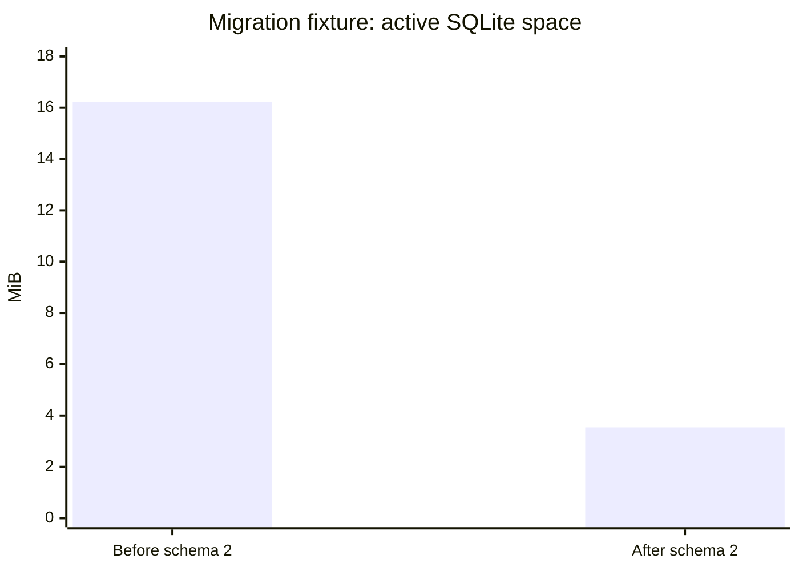
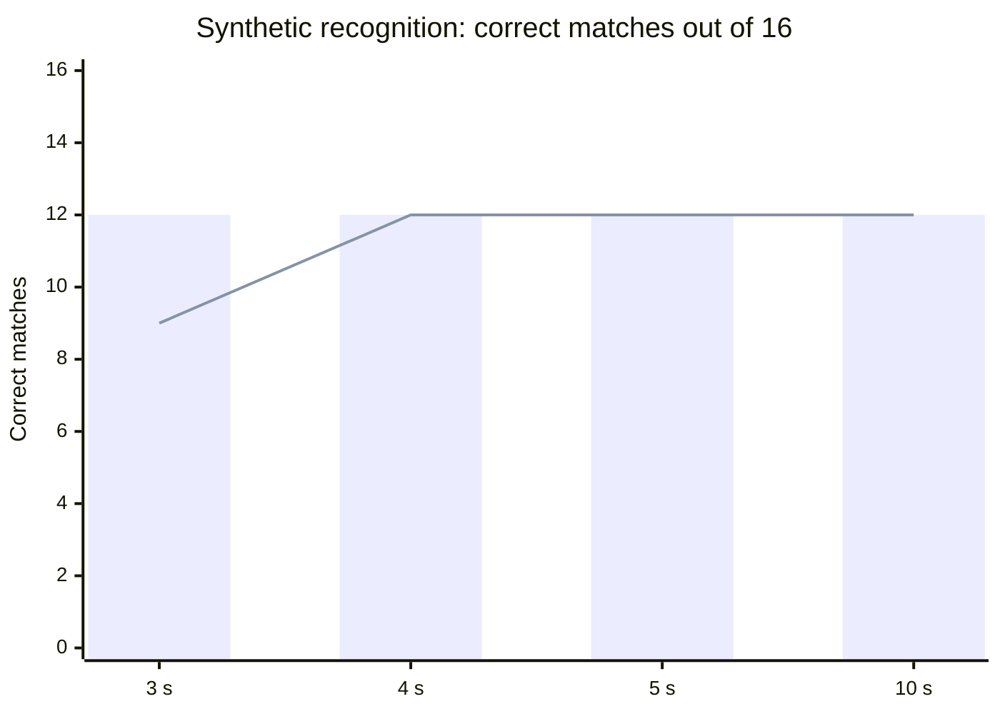

# Benchmarks

[Home](../README.md) · [Documentation](README.md)

## Benchmark results and shipped optimizations

These are local prototype measurements, not performance guarantees or recognition rates for a music catalogue. Storage, document size, extraction time and recognition accuracy measure different things and must not be combined into a single improvement percentage. Historical optimization measurements below were collected during development; the short-capture experiment was run on 2026-11-15.

### Database storage

Schema 2 replaced hexadecimal TEXT hashes with ten-byte BLOBs, introduced internal integer reference IDs and used a `WITHOUT ROWID` landmark table. Public reference keys, acoustic hashes and offsets were preserved. The query-first indexed join avoided the full landmark scan seen in the initial compact-layout experiment.

| Measurement | Before | After | Interpretation |
| --- | ---: | ---: | --- |
| Generated v2 migration fixture, 71,954 landmarks: active SQLite pages | 16.23 MiB | 3.54 MiB | About 78% less active space for this fixture |
| Deployed database after schema 2 migration: physical file | Not a controlled comparison | 4,502.23 MiB | File still includes reusable pages; no `VACUUM` performed |
| Same deployed database: active / reusable space | Not a controlled comparison | 893.57 / 3,608.66 MiB | Freed pages can be reused without shrinking the file |

The deployed snapshot contained 274 references. It is a historical snapshot, not the current database size or a projection per song. An earlier upper-limit synthetic baseline with 36 MB JSON and one million landmarks occupied about 238.3 MiB; it was not a before/after measurement of the deployed collection. Schema 3 subsequently compacted stored submission documents; no isolated schema 3 space-saving percentage was measured. Transactional upgrades, pre-upgrade backups including WAL data, and rejection of unsupported layouts are shipped safeguards, not speed or size improvements. None of these upgrades resets the collection.

#### Deployed storage snapshot

A read-only measurement using schema 7 found:

| Measurement | Result |
| --- | ---: |
| Occupied SQLite pages, including indexes and metadata | **1,418.54 MiB (1.385 GiB)** |
| Stored acoustic references, including unpublished references | 575 |
| Published acoustic references | 460 |
| Distinct verified recording identities among published references | 426 |
| Published references without a verified recording identity | 32 |
| Stored landmarks | 38,637,618 |

The occupied-page figure excludes reusable free pages, but includes all database tables and indexes, not just published fingerprints. It is measured as `(page_count - freelist_count) * page_size` using SQLite's read-only `PRAGMA` queries.

This is a real deployment example, not a per-song storage guarantee. Track duration, landmark density, multiple acoustic variants of the same recording, pending submissions and cached metadata all affect storage. Published references without verified identities cannot safely be deduplicated into logical recordings, so the reference count must not be interpreted as a count of unique songs.

### Library extraction and document encoding

The shipped library 0.3.0 preserves the landmark algorithm while reducing Python scalar-conversion overhead and adding the lossless `sha1-80-offset-delta-v1` codec. The server accepts both compact and legacy documents with the same canonical identity. Earlier shipped extraction changes process FFTs in 64-frame batches with the peak-filter halo and avoid retaining a full-window spectrogram. Streaming reference analysis keeps a bounded rolling PCM window. These memory bounds preserve exact hashes and offsets; no measured peak-memory reduction is reported here.

| Measurement | Result | Scope |
| --- | --- | --- |
| Extraction, 30-second noise fixture | 69.662 to 67.110 ms; about 3.66% less time | Alternating local comparison, 30 runs |
| Extraction, 30-second silence-gap fixture | 58.322 to 57.122 ms; about 2.06% less time | Same comparison method |
| Extraction, 30-second tone fixture | 46.348 to 46.312 ms | No meaningful improvement |
| Production compact landmark JSON section | About 49-50% smaller | 60-second synthetic noise/tone fixtures; includes base64 and encoding field, excludes the rest of the document |
| Compact encoding / decoding | About 42 / 21 ms median | 23,986 noise landmarks; additional codec work, not total upload latency |

Earlier representation experiments found approximately 53% savings for ten-byte hashes with fixed-width offsets and 63% for delta-varint offsets **before base64**, relative to canonical JSON pairs. Adding zlib to the delta representation reached approximately 64%; JSON with zlib reached approximately 49%. These used synthetic v2 documents and three existing processed v1 reference documents, not a representative catalogue. Fixed-width encoding and zlib remain experiments, not production formats. The raw 63% saving must not be presented as the JSON/API saving. See the [library benchmark documentation](https://github.com/dmoo500/audio-fingerprint#lossless-optimization-benchmarks) for repeatable compression commands and compatibility details.

### Short-capture recognition

The experiment used the unchanged production HTTP extraction, matching and acceptance path with an isolated database: library revision `cbfa2fc`, server revision `d17387f`, minimum 30 matches and minimum match fraction 0.02. No live collection, credentials or stored audio were used or changed.

Four independent 30-second synthetic references were indexed: two changing harmonic/percussive signals (seeds 101 and 202) and two white-noise signals (303 and 404). Each query began at 2.137, 7.431, 13.819 or 17.203 seconds, without snapping to FFT hops. For each duration/noise condition there were 16 known-reference queries and three controls: an unknown harmonic signal (505), unknown noise (606) and silence. White noise was added at a measured RMS signal-to-noise ratio (SNR), with deterministic seed `912 + start_sample`; peaks above 0.95 were uniformly scaled before float32 encoding.

| Capture duration | Clean | 20 dB SNR | 10 dB SNR | 0 dB SNR |
| --- | ---: | ---: | ---: | ---: |
| 1 second | HTTP 422 | HTTP 422 | HTTP 422 | HTTP 422 |
| 2 seconds | HTTP 422 | HTTP 422 | HTTP 422 | HTTP 422 |
| 3 seconds | 12/16 | 12/16 | 9/16 | 1/16 |
| 4 seconds | 12/16 | 12/16 | 12/16 | 2/16 |
| 5 seconds | 12/16 | 12/16 | 12/16 | 1/16 |
| 10 seconds | 12/16 | 12/16 | 12/16 | 0/16 |

Entries are correct title-and-position matches, not just returned candidates. Position was checked within two FFT hops of the known start. Bars below show clean queries; the line shows 10 dB SNR queries. The table also retains the stronger-noise results.

Across 456 requests, 152 were rejected because the API requires at least three seconds. Of 256 supported known-reference queries, 145 matched correctly and 111 returned `no_match`; there were no wrong-title, wrong-position or ambiguous results. All 48 supported unknown/silence controls returned `no_match`. Each isolated duration/noise cohort remained below the unchanged request-rate limit. Clean harmonic/percussive queries matched at all eight positions even at three seconds; the four clean failures per duration came from the white-noise references.

Local median HTTP processing time, excluding capture time, real networking and gateway overhead, was approximately 9-10 ms at three seconds, 13-14 ms at four seconds, 16 ms at five seconds and 30-31 ms at ten seconds. These timings use a tiny collection and do not predict deployed lookup latency.

The synthetic results support testing 3-5-second clean line-in captures, but do not establish real line-in or microphone accuracy. Additive noise does not model room reverberation, speaker response or microphone processing. Ten seconds did not reliably overcome strong noise, and longer captures did not monotonically improve results. One- and two-second recognition quality was not measured because the API rejected them. The browser still captures ten seconds; no capture duration or threshold was changed.

### Validation snapshots

The published codec work was validated with 79 passing library tests, 139 passing receiver tests plus one skipped opt-in test, and 100 passing focused MA tests. Coverage included exact codec round trips and canonical identity, decoded limits, legacy compatibility, transactional migrations and WAL-aware backups, HTTP ingestion and recognition, and MA upload consent. These are historical run counts, not the current suite size. The full MA pre-commit mypy hook was blocked by existing Hue/Deezer typing errors; focused checks passed and the commit skipped only that hook with explicit approval. No full-repository type-check success is claimed.

The later MA metadata-repair work had 194 passing focused tests but is not part of the pushed optimization revisions summarized here. The short-capture benchmark is a separate experiment, not a production capture-duration change.
