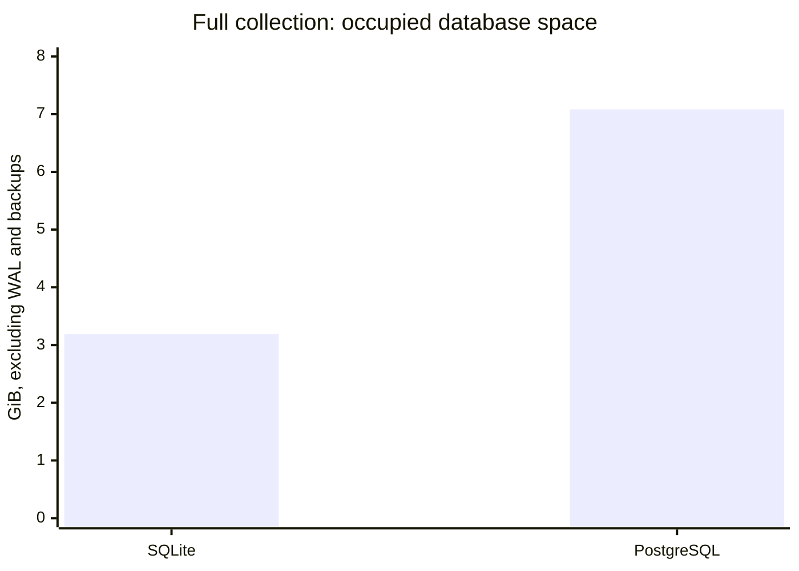

# Benchmarks

[Home](../README.md) · [Documentation](README.md)

## Benchmark results and shipped optimizations

These are local prototype measurements, not performance guarantees. Storage,
document size, lookup latency and recognition accuracy measure different things;
do not combine them into one improvement percentage. Each topic retains its
dataset, environment, dates and limitations.

| Topic | What you will find |
| --- | --- |
| [SQLite storage](benchmarks/sqlite-storage.md) | Historical schema changes, deployed growth chart and occupied versus reusable space |
| [PostgreSQL storage and layouts](benchmarks/postgresql-layout.md) | Storage comparison, index/heap overhead and alternative hash/ID layouts |
| [PostgreSQL migration and runtime](benchmarks/postgresql-runtime.md) | Verified full import, recognition parity, worker restart, dump and restore |
| [Extraction, encoding and recognition](benchmarks/audio.md) | Codec savings, extraction timings and short synthetic captures |
| [Two-API functional trial](replicas.md#tested-and-not-tested) | Real APISIX distribution, API exclusion/rejoin and shared limits on synthetic data |

### Latest full-collection comparison

The 2026-11-17 rehearsal used 837 references and 56,878,950 landmarks.
PostgreSQL occupied **7.083 GiB**, compared with **3.189 GiB** of occupied SQLite
pages: **2.22 times** as much. Neither figure includes backups or WAL.

Warm runtime lookup medians were 118.36 ms for SQLite and 125.04 ms for
PostgreSQL. Fifty sampled outcomes agreed, including four candidate-limit
rejections. This was not a microphone accuracy or sustained-load test.
See the [complete runtime rehearsal](benchmarks/postgresql-runtime.md#full-collection-runtime-and-restore-rehearsal)
for methodology, backup checks and operational limits.

## Topic shortcuts

The headings below retain links from earlier documentation versions.

### Database storage

[SQLite measurements and growth](benchmarks/sqlite-storage.md) ·
[PostgreSQL layout comparison](benchmarks/postgresql-layout.md)

#### Experimental PostgreSQL comparison

[Initial comparison and its limitations](benchmarks/postgresql-layout.md#experimental-postgresql-comparison)

#### PostgreSQL layout and migration investigation

[Layout experiments](benchmarks/postgresql-layout.md#postgresql-layout-and-migration-investigation) ·
[Offline migration](benchmarks/postgresql-runtime.md#offline-migration)

#### Full-collection runtime and restore rehearsal

[Complete measurements and readiness assessment](benchmarks/postgresql-runtime.md#full-collection-runtime-and-restore-rehearsal)

#### Deployed SQLite storage snapshots

[Historical schema 7 growth](benchmarks/sqlite-storage.md#deployed-sqlite-storage-snapshots)

### Library extraction and document encoding

[Extraction and codec measurements](benchmarks/audio.md#library-extraction-and-document-encoding)

### Short-capture recognition

[Synthetic recognition results and chart](benchmarks/audio.md#short-capture-recognition)

### Validation snapshots

[Historical validation scope](benchmarks/audio.md#validation-snapshots)
