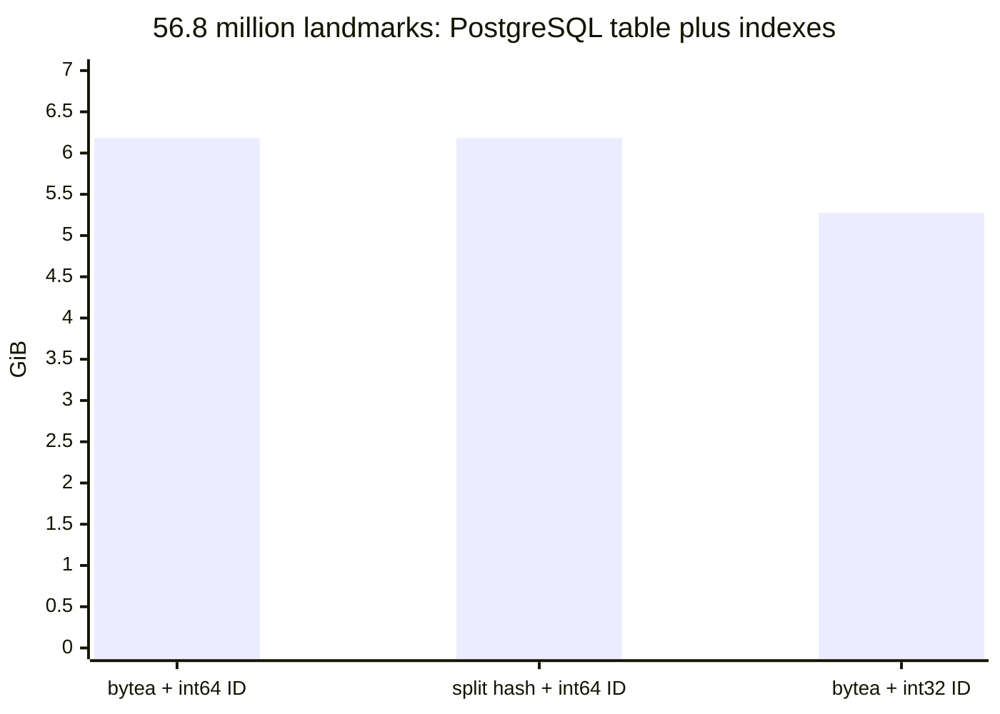

# PostgreSQL storage and query layouts

[Home](../../README.md) · [Documentation](../README.md) · [Benchmark overview](../benchmarks.md)

## Experimental PostgreSQL comparison

The server now has an optional PostgreSQL backend. The original
`scripts/postgres_benchmark.py` remains an isolated storage/query experiment,
not the runtime or a production migration.
It copies a schema 7 or 8 SQLite backup, adds the schema 8 landmark index to the
copy if needed, imports its tables and comparable indexes into a temporary local
PostgreSQL 17 container, and checks row counts and exact recognition-candidate
sets for a small sample. It reports storage and warm candidate-query timings.
The benchmark removes the temporary container and copy when it exits normally.
It requires Docker, local disk space for both databases and temporary indexes,
and an existing, consistent offline backup; never point it at a live WAL database.

For the newer complete-runtime results, see the
[full-collection rehearsal](postgresql-runtime.md#full-collection-runtime-and-restore-rehearsal).

On 2026-11-17, one local run used the same schema 7 backup for both databases,
adding the schema 8 index to the SQLite copy. It contained 836 references and
56,816,420 landmarks. PostgreSQL 17.12 ran in Docker Desktop; SQLite 3.53.4 ran
natively on the ARM64 macOS host. The five approximately six-second samples came directly
from published submissions; they were not microphone captures.

| Measurement | SQLite | PostgreSQL |
| --- | ---: | ---: |
| Whole database: occupied SQLite pages / PostgreSQL database size | 3.186 GiB | 7.075 GiB |
| Landmark table and its indexes | 2.333 GiB | 6.182 GiB |
| Median warm candidate query, 15 runs | 72.21 ms | 263.26 ms |

All imported table row counts and the candidate multisets for all five samples
matched. The PostgreSQL import and index construction took 104 seconds, excluding
creation of the SQLite copy and its index. PostgreSQL's database size includes
system catalogs; SQLite's occupied pages exclude reusable pages. Neither figure
includes the backup, WAL or temporary build space.

```sh
uv run --no-sync --with 'psycopg[binary]>=3.2,<4' \
  python scripts/postgres_benchmark.py /path/to/offline-backup.db
```

Candidate-query timings do not include the full recognition pipeline, concurrent
load, cache-cold performance or a hosted database's network latency. Exact match
results are checked only for the chosen samples. Row counts do not prove that
every imported value is identical, and the script does not migrate or validate a
production installation.

## PostgreSQL layout and migration investigation

`scripts/postgres_layout_experiment.py` separately imports the backup into the
baseline PostgreSQL layout and two experimental alternatives: one represents each
80-bit hash as two reversible signed integers; the other retains the hash and
uses 32-bit internal reference IDs. All retain the unique landmark key, the
reference lookup index and the foreign key. It reports table/index sizes and
analyzed plans before and after `VACUUM`, then compares sampled candidate
multisets and warm timings. The 32-bit alternative rejects IDs outside its range;
it would impose a hard long-term limit. This is an experiment, not a change to
the stored fingerprint format or a production-ready migration.

On 2026-11-17 the same 56,816,420-landmark backup was tested with five samples
and three timed repetitions per sample, locally on PostgreSQL 17.12. All three
layouts returned the same candidate multisets for these samples:

| Landmark layout, including both indexes | PostgreSQL size | Median warm query |
| --- | ---: | ---: |
| 10-byte `bytea` hash, 64-bit reference ID | 6.183 GiB | 69.55 ms |
| Two integer hash columns, 64-bit reference ID | 6.182 GiB | 2,246.84 ms |
| 10-byte `bytea` hash, 32-bit reference ID | 5.275 GiB | 53.38 ms |

These are table-and-index sizes, not whole databases; the 32-bit layout saved
about 14.7% for landmarks in this run. The signed 32-bit range is a permanent
capacity limit unless a future migration expands it. All timings include local
query result transfer and Python decoding, use a fixed query order and warm
caches, and are not a concurrent-load benchmark.



The smaller int32 layout was not selected: its size benefit introduces an
additional permanent capacity limit, and this one experiment is insufficient
to select a production representation.

The first baseline plan used an index-only scan but still performed 15,618 heap
fetches. After `VACUUM (ANALYZE)`, the sampled plan had zero heap fetches and a
hash join for published references. The individual plan execution times are not
a controlled vacuum speed comparison because the first run also read cold pages.
For the two-integer hash, the sampled planner estimated one index row per probe,
while observing approximately 31; it chose a reference-index nested loop with
16,967 lookups. That poor estimate and plan coincided with the much slower
measurement; other statistics and query shapes were not exhaustively tested.
The 32-bit reference layout retained an index-only scan and hash join for the
sample. Do not select any production layout from this single experiment alone.

## Lossless posting-list experiment

On 2026-11-17, `scripts/postgres_postings_experiment.py` compared the current
one-row-per-landmark representation with two array layouts in a disposable
PostgreSQL 17 container limited to two CPUs and 4 GiB RAM. It reads an offline
SQLite backup, never the active PostgreSQL database.

The largest run included every publication-ready reference in that backup:
730 references and 50,845,688 landmarks. This is **not the whole stored catalogue**:
unpublished references were excluded. All 930 submission documents were tested
separately for compression.

| Landmark layout, including lookup indexes | Size | Change |
| --- | ---: | ---: |
| Current rows with 64-bit reference IDs | 5.533 GiB | baseline |
| One row per hash/reference, array of offsets | 5.737 GiB | +3.7% |
| One row per hash, paired reference-ID/offset arrays | 1.695 GiB | -69.4% |

Every layout decoded to the same sorted landmark SHA-256:
`32095ea81c338aa19557d6185fcb8077df9d51ca5be5504295addd5d58bd0c59`.
Ten queries of up to 400 landmarks returned identical candidate multisets.
Removing one reference also left identical decoded landmark collections.

The single-pass query medians were 130.99 ms, 1,934.80 ms and 16.89 ms
respectively. These are exploratory timings, not a recognition latency or
throughput guarantee: query order was fixed, caches were not controlled, and
the queries omit the production publication join. There were no microphone,
concurrent update, restart, or complete recognition-pipeline tests.

The hash-grouped layout retains all 80 hash bits, 64-bit reference IDs and
32-bit offsets. Its indexes are a hash primary key and a GIN reference-ID
lookup. Unlike the baseline, the arrays do not enforce individual landmark
uniqueness or per-element foreign keys. A production design must address
these invariants, bounded large postings, concurrent ingestion and deletions,
and forward/reverse migration before adoption. No live schema was changed.

Changing submission text compression from `pglz` to `lz4` reduced these
930 documents and their index from 961,445,888 to 960,741,376 bytes, only
0.07%. It is not a useful size optimization for this sample.

```sh
uv run --no-sync python scripts/postgres_postings_experiment.py \
  /path/to/offline-backup.db --references 1000 --report /tmp/postings-result.json
```

The reference limit selects publication-ready references in ID order, not a
random sample. It also caps the separately selected submission documents.
The disposable container is removed on normal completion, and the report
records exact sizes, equality checks and analyzed query plans.

### Bounded runtime prototype: storage regression

A subsequent full runtime rehearsal used every stored reference, including
unpublished references: 845 references and 57,373,098 landmarks. The prototype
partitioned each hash into reference-ID blocks of 32 and offset blocks of
1,024 to bound individual arrays, and added array/integrity checks and triggers.

| Landmark layout, including indexes | Bytes | GiB |
| --- | ---: | ---: |
| Row layout (format 1 at the time) | 6,704,136,192 | 6.244 |
| Bounded format-2 prototype | 8,410,185,728 | 7.833 |

This is **25.4% larger**, not a space saving. Fixed block boundaries fragment
the lists and invalidate any extrapolation from the unbounded experiment.
The prototype was not deployed to the running database.

The rehearsal did pass full canonical landmark checksum verification, 50
recognition-outcome comparisons (46 ranked results, four explicit candidate-limit
errors), 100 availability comparisons, HTTP ingestion/PCM recognition, worker
restart and orphan cleanup. Exporting the changed collection to SQLite and
restoring a PostgreSQL dump also passed content and recognition checks.
These correctness checks do not compensate for the failed storage goal.
Further layout work must demonstrate a size reduction with bounded postings
before a local cutover is justified.

```sh
uv run --no-sync --with 'psycopg[binary]>=3.2,<4' \
  python scripts/postgres_layout_experiment.py /path/to/offline-backup.db
```
