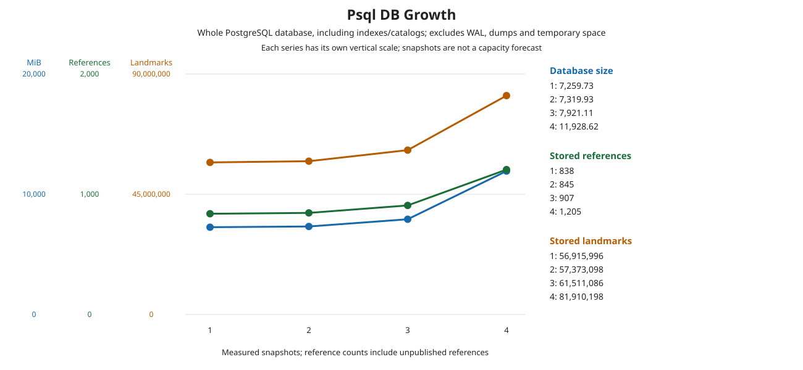

# PostgreSQL migration and runtime rehearsal

[Home](../../README.md) · [Documentation](../README.md) · [Benchmark overview](../benchmarks.md)

## Database growth



The first two points are format-1 imports during isolated migration rehearsals
(838 and 845 references), not observations of one continuously running database.
The third is a read-only measurement of the live format-1 service on
2026-11-17 at 20:42 UTC: 8,305,890,995 bytes (7,921.11 MiB), 907 stored references
and 61,511,086 landmarks. The service remained active during measurement;
physical relation sizes are not transaction-snapshotted.

PostgreSQL size includes every table, index, TOAST value and database catalog,
but excludes WAL (1 GiB at the live measurement), dumps and temporary space.
Each series has its own vertical scale. This is measured storage, not a linear
growth forecast or a direct comparison with SQLite occupied pages.
Update measured points and provenance in [`database-growth.json`](../database-growth.json),
then run `python scripts/render_database_growth.py` to regenerate both charts.
The [SQLite chart](sqlite-storage.md#deployed-sqlite-storage-snapshots) includes
the separately verified SQLite return export.

## Offline migration

An experimental SQLite-to-PostgreSQL importer is available for a **schema 10**
SQLite database or backup. It takes a consistent SQLite backup (including
committed WAL), validates SQLite integrity and foreign keys, and creates a new
PostgreSQL schema in a single transaction. It retains SQLite submission rowids
as `queue_order`, copies all stored fields and verifies every metadata row plus
a binary SHA-256 checksum and row count for all landmarks. It builds constraints
and indexes, and sets identity sequences above the imported IDs. An error rolls
back the new schema; an existing schema is never overwritten.

Connection settings are read from standard libpq environment variables, not
command-line credentials. Use a securely managed `PGPASSFILE` for passwords and
an authenticated encrypted PostgreSQL connection for remote databases. For
example, with connection settings already configured:

```sh
uv run --no-sync --with 'psycopg[binary]>=3.2,<4' \
  python scripts/migrate_sqlite_to_postgres.py /path/to/backup.db \
  --schema fingerprint_import
```

Allow disk space for the temporary SQLite copy, PostgreSQL tables, indexes,
WAL and backups. The tool does not delete the source or import into an existing
schema. Older backups must first be upgraded to schema 10 **on a separate copy**
using the existing SQLite migration; retain the unmodified backup. The importer
creates PostgreSQL format 3, shared with the optional
[runtime backend](../operations/deployment.md#optional-postgresql-backend). It does not change
the running server's configuration or enable PostgreSQL automatically.

The importer was tested against an isolated copy of the schema 7 backup after
adding the schema 8 index: 917 submissions, 836 references, 1,315 cache entries,
two service-state entries and 56,816,420 landmarks were verified in 272.7 seconds
on the local setup. This excludes making the SQLite copy and is not a hosting or
network performance estimate. No live cutover was performed.

An eventual production cutover still requires a separately approved, tested
procedure:

1. Stop admission and workers, retain a verified SQLite backup and import a
   consistent, quiescent snapshot into an empty PostgreSQL database.
2. Preserve all submissions, their FIFO tie-break order and retry state, reference
   IDs and keys, metadata, fingerprints, cache, deadlines and service state.
   Establish a PostgreSQL ID sequence above the largest imported reference ID.
3. Validate source integrity, schema and types, constraints and foreign keys;
   compare deterministic per-table content checksums as well as row counts and
   recognition results before enabling writes. Sample equality alone is not
   enough. Fail the cutover on any discrepancy.
4. Start one PostgreSQL-backed worker and verify health, queue recovery,
   idempotent uploads, publication and recognition. Keep the original and backup
   for recovery; once PostgreSQL accepts new writes, restoring the old SQLite
   snapshot alone would lose them, so rollback needs an explicit reconciliation
   or reverse migration.

The optional runtime backend now uses the importer's shared schema definitions.
Isolated integration tests cover imported-fixture recovery, matching/statistics/
availability equality with SQLite, real HTTP ingestion and synthetic PCM
recognition, concurrent queue admission, safe housekeeping, split API/worker
roles and ownership-connection failure. The following full-collection rehearsal
also exercises the actual runtime; neither test establishes sustained parallel
load capacity. These original measurements predate reverse migration; the
[current migration guide](../operations/database-migration.md) also documents the verified
PostgreSQL-to-SQLite exporter.

At the time of this full-collection rehearsal, the runtime deliberately
rejected multiple APIs. A subsequent [two-API trial](../operations/replicas.md) added opt-in
shared API membership, shared request budgets and two database-wide recognition
slots behind APISIX. The full-collection measurements below still describe one
API and one worker, not multi-API throughput. A single ingestion owner preserves
in-process MusicBrainz pacing. PostgreSQL is not a space-saving replacement for
SQLite based on these measurements.

## Full-collection runtime and restore rehearsal


On 2026-11-17, a fresh consistent backup was made through a **read-only**
connection to the running SQLite schema 8 database. The live service was not
reconfigured or restarted. The snapshot contained 918 submissions, 837 acoustic
references, 56,878,950 landmarks, 1,316 cache entries and two service-state entries.
The trial used PostgreSQL 17.12 in a disposable local container limited to two
CPUs and 4 GiB RAM. SQLite ran natively on the macOS ARM64 host, without those
container limits.

The importer checked every metadata field and all landmarks before any trial
mutations. Import and verification took **316.6 seconds**, excluding the SQLite
snapshot and the subsequent PostgreSQL vacuum/analyze. Sizes after
`VACUUM (ANALYZE)`, before synthetic additions:

| Measurement | SQLite | PostgreSQL |
| --- | ---: | ---: |
| Occupied SQLite pages / whole PostgreSQL database | 3.189 GiB | 7.083 GiB |
| Landmarks including indexes | 2.335 GiB | 6.190 GiB |
| Physical SQLite file, including reusable pages | 4.397 GiB | Not a comparable PostgreSQL measure |

PostgreSQL therefore still needed **2.22 times** the occupied SQLite space.
Its landmark heap alone used 3.191 GiB; the remainder of the landmark total was
indexes and relation support storage. The container also held **1.000 GiB of
PostgreSQL WAL** at this checkpoint, outside the database-size figure. Backups,
the restored database and temporary build space are additional requirements.
These are measurements of one collection and configuration, not a storage forecast.

Fifty deterministic approximately six-second landmark excerpts were selected
from distinct published references. Complete `Store.match()` results were equal
across the two backends, including ranking, offsets, counts and metadata:
46 excerpts returned ranked candidates and four hit the same explicit
100,000-candidate safety limit on both backends. Those 46 are **not** a count of
HTTP-accepted or microphone matches. Statistics and availability output for 100
verified reference-derived items were also equal.

After an initial comparison/warmup, each sample was measured three times:

| Warm runtime lookup, 150 calls per backend | SQLite | PostgreSQL |
| --- | ---: | ---: |
| Median | 118.36 ms | 125.04 ms |
| Maximum observed | 334.58 ms | 281.35 ms |

These timings include connections, query-table creation, candidate retrieval,
Python ranking and metadata reads, or the explicit candidate-limit rejection.
They exclude audio extraction, HTTP and real network latency. The fixed query
order, warm caches, different runtime environments and sampled corpus prevent
a general performance claim; PostgreSQL's median was about 5.6% higher in this
run, rather than the much larger gap in the initial candidate-query experiment.

The actual Uvicorn API and standalone worker then ran in separate loopback
subprocesses against the complete PostgreSQL collection. Imported open work was
paused **only in the test copy after parity checks**. Synthetic fixtures passed:

- HTTP ingestion, locally stubbed identifier verification and atomic publication.
- A known synthetic PCM excerpt recognized with the correct recording identity
  through the production HTTP path; this one request took 134.12 ms.
- Worker shutdown detected by health checks, followed by restart and recovery
  of an interrupted synthetic claim.
- Scheduled missing-identifier cleanup deleting the synthetic submission,
  unused unpublished reference and its landmark.
- Four store lookups with two concurrent callers, unchanged results; median
  154.20 ms. This tiny bounded check is not a parallel-load benchmark.

Only one MusicBrainz request occurred, to a loopback stub serving the synthetic
recording. No real catalogue verification or duplicate processing occurred.

After stopping the test API and worker, a custom-format `pg_dump` took
**66.0 seconds** and occupied **1.045 GiB**. It was restored into a second empty
PostgreSQL database. Every application table, including all 56,883,840 landmarks
present after synthetic publication/cleanup, matched its pre-backup binary
SHA-256 checksum and row count. The restored runtime validated its schema and
returned the same outcomes for all 50 recognition samples. Restore plus content
and recognition verification took **193.0 seconds**; this is not restore time
alone or a remote-host recovery-time guarantee.

The rehearsal passed and all temporary databases, dump, SQLite snapshot and
test subprocesses were removed. The unchanged live service remained healthy.
The reproducible tool is `scripts/postgres_runtime_trial.py`; see
[full-collection rehearsal instructions](../development.md#validation-and-limitations).

**Readiness:** this removes the untested full-collection runtime/import/restore
step for this local setup. It supports planning a controlled single-API,
single-worker switch, not certifying multi-pod capacity or an unattended live cutover.
A destination, disk/backup budget, final quiescent import and explicit rollback
decision are still required. Restoring PostgreSQL has been tested; migrating new
PostgreSQL writes back into SQLite was not part of this original measurement.
The subsequent [reverse migration rehearsal](../operations/database-migration.md#reproducible-checks)
uses a new SQLite file and explicitly includes post-import changes.
