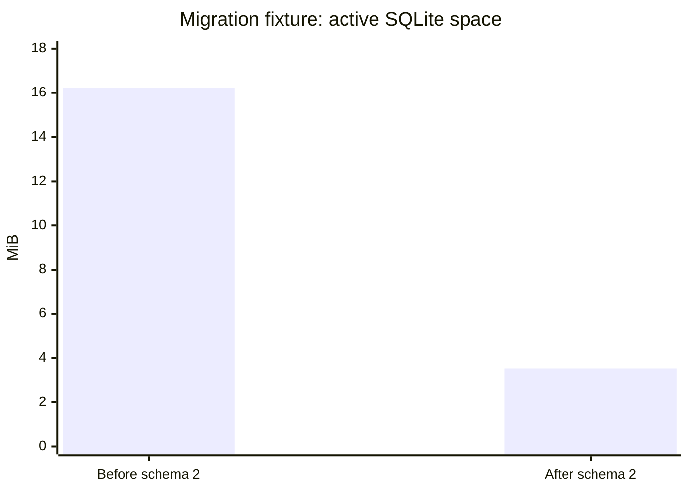

# SQLite storage benchmarks

[Home](../../README.md) · [Documentation](../README.md) · [Benchmark overview](../benchmarks.md)

## Database storage

Schema 2 replaced hexadecimal TEXT hashes with ten-byte BLOBs, introduced internal integer reference IDs and used a `WITHOUT ROWID` landmark table. Public reference keys, acoustic hashes and offsets were preserved. The query-first indexed join avoided the full landmark scan seen in the initial compact-layout experiment.

| Measurement | Before | After | Interpretation |
| --- | ---: | ---: | --- |
| Generated v2 migration fixture, 71,954 landmarks: active SQLite pages | 16.23 MiB | 3.54 MiB | About 78% less active space for this fixture |
| Deployed database after schema 2 migration: physical file | Not a controlled comparison | 4,502.23 MiB | File still includes reusable pages; no `VACUUM` performed |
| Same deployed database: active / reusable space | Not a controlled comparison | 893.57 / 3,608.66 MiB | Freed pages can be reused without shrinking the file |

The deployed snapshot contained 274 references. It is a historical snapshot, not the current database size or a projection per song. An earlier upper-limit synthetic baseline with 36 MB JSON and one million landmarks occupied about 238.3 MiB; it was not a before/after measurement of the deployed collection. Schema 3 subsequently compacted stored submission documents; no isolated schema 3 space-saving percentage was measured. Transactional upgrades, pre-upgrade backups including WAL data, and rejection of unsupported layouts are shipped safeguards, not speed or size improvements. None of these upgrades resets the collection.

## Deployed SQLite storage snapshots

Three read-only SQLite measurements using schema 7 illustrate how the database grew as
references and landmarks were added. They are an example of possible growth, not
a forecast: future storage needs depend on the contributed recordings. These
measurements predate the schema 8 reference index and do not represent PostgreSQL.

The chart uses a separate vertical scale for each measurement; line slopes across
different scales are not directly comparable.

The chart now also includes the schema 8 pre-PostgreSQL backup (3,299.09 MiB,
845 stored references, 57,373,098 landmarks) and the verified SQLite return
export from the isolated compact-runtime rehearsal (3,336.75 MiB file size, 846 references,
57,377,988 landmarks). Snapshot 5 includes synthetic test changes and was
never the live database.
The return point is a newly created file whose occupied pages were not separately
measured; its size uses a hollow marker and dashed segment, not a claim that file
size equals occupied pages. The early schema 7 points predate a secondary index, so the change in size is
not solely collection growth. The chart uses **all stored references**, including
unpublished ones; the earlier version of this diagram displayed published counts.

Snapshot 6 measures the live SQLite database after the return from PostgreSQL:
**6,673.21 MiB occupied**, **1,714 stored references** and **116,999,128 landmarks**.
The main database measured 6,674.29 MiB including reusable pages, excluding WAL.

Occupied space rose from 1,418.54 to 2,111.26 MiB; published references from 460 to 715;
and stored landmarks from 38,637,618 to 56,424,148. Stored acoustic references, including
unpublished ones, numbered 575, 670 and 830. Published references had 426, 521 and 680
distinct verified recording identities, respectively, and 32, 32 and 33 references without
a verified identity.

The occupied-page figure excludes reusable free pages, but includes all database tables and indexes, not just published fingerprints. It is measured as `(page_count - freelist_count) * page_size` using SQLite's read-only `PRAGMA` queries.

This is a real deployment example, not a per-song storage guarantee. Track duration, landmark density, multiple acoustic variants of the same recording, pending submissions and cached metadata all affect storage. Published references without verified identities cannot safely be deduplicated into logical recordings, so the reference count must not be interpreted as a count of unique songs.

Snapshot values and provenance for both database charts live in
[`database-growth.json`](../database-growth.json). Add measured points there and
run `python scripts/render_database_growth.py` to regenerate
`sqlite-db-growth.svg` and `psql-db-growth.svg`. Keep occupied SQLite pages
separate from physical file size; see the [PostgreSQL chart](postgresql-runtime.md#database-growth)
for its different size definition.
