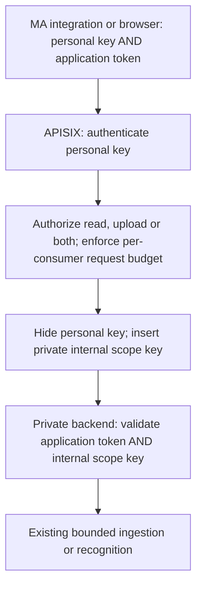

# Credentials and APISIX gateway

[Home](../README.md) · [Documentation](README.md)

## API keys and future administration

**Default / legacy mode:** two shared secrets supplied through environment variables, with no API-key database or admin UI in the fingerprint server.

| Key | Access |
| --- | --- |
| `FP_UPLOAD_KEY` | Submit references, check availability and read submission status |
| `FP_READ_KEY` | Recognize PCM and read collection statistics |

Availability uses the upload role and both gateway credentials, with its own per-consumer rate limit so preflight requests do not consume the submission route's allowance. Re-run the existing gateway configuration process after upgrading to install the new route; existing personal credentials are preserved.

In this default mode there are no individual accounts, per-contributor credentials, expiry dates or individual revocation. Rotation requires changing the configured secret and restarting the service; all clients using that secret must be updated. Request budgets are shared per scope within the process, not assigned to individual users. The browser keeps its read key only in the current page, but anyone holding that key has its full permissions. There is no public self-service key issuance.

### Optional APISIX mode: application token AND personal token

This deployment uses [Apache APISIX](https://apisix.apache.org/) for administratively issued personal keys. It is opt-in; the existing local setup and `compose.yaml` remain unchanged. There is no self-service developer portal, user login or automatic expiry. The application token is a separate fingerprint-service credential, **never** a login token from a local MA instance and not an officially issued Music Assistant credential. This pilot supports one configured application token.



APISIX checks the personal key; the server checks the client-supplied application token using a constant-time comparison. The gateway does not manufacture or substitute the application token. It replaces `X-API-Key` with the internal read/upload key only after personal-key authentication. An application token alone, a personal key alone, or forged consumer headers cannot grant API access. The backend ignores consumer headers for permissions; APISIX uses its authenticated consumer context for permissions and limits. The verified consumer username is forwarded only for audit logging.

Personal credentials and gateway configuration live in APISIX's separate etcd volume, not the fingerprint database. No fingerprint schema migration is needed. `FP_UPLOAD_KEY` and `FP_READ_KEY` become private gateway-to-backend secrets and must not be issued to participants. Shared application tokens embedded in distributed software can be extracted; they identify an application convention, not prove its authenticity or act as a second factor for a user. Personal keys remain the individual revocable access credential.

#### Start and configure

Use the same Compose project/directory as the existing deployment to retain its `fingerprints` volume. **Do not combine the two Compose files**: the gateway file is a complete alternative, with no published backend port. A differently named Compose project selects a different volume and does not migrate your collection automatically. Native runs using `data/fingerprints.db` still require a deliberate database transfer before switching to Docker; do not copy a live WAL database.

Set the existing internal keys and generate two additional independent secrets:

```sh
export FP_GATEWAY_ENABLED=true
export FP_APPLICATION_KEY="$(uv run --no-sync python -c 'import secrets; print(secrets.token_urlsafe(32))')"
export FP_GATEWAY_ADMIN_KEY="$(uv run --no-sync python -c 'import secrets; print(secrets.token_urlsafe(32))')"
# FP_UPLOAD_KEY and FP_READ_KEY must also be exported for the provisioning command.
docker compose -f compose.yaml stop fingerprints
docker compose -f compose.gateway.yaml up --build -d
uv run --no-sync python -m fingerprint_server.gateway configure
```

Wait for APISIX to start before running `configure`; failures are reported and the command can be repeated. It updates the managed routes and role groups, preserving personal keys. Until routes are configured, the gateway has no public catch-all route to the backend. The gateway proxy is at `http://localhost:8097`; its Admin API is bound to loopback port 9180. The etcd service has no host port. Keep Admin API access private and never give its key to a developer or browser. The loopback proxy needs an HTTPS front end before remote use; microphone access also requires HTTPS outside localhost.

#### Issue, rotate and revoke personal keys

The commands use the local Admin API and require `FP_GATEWAY_ADMIN_KEY` in the environment:

```sh
uv run --no-sync python -m fingerprint_server.gateway issue my-ma-installation --role both
uv run --no-sync python -m fingerprint_server.gateway issue microphone-test --role read
uv run --no-sync python -m fingerprint_server.gateway revoke microphone-test
```

`issue` prints the newly generated personal key for private delivery to its recipient. Roles are `read` (recognition/statistics), `upload` (submissions/status) and `both`. Issuing again for an existing name **replaces its key and role**, invalidating the previous key after the gateway observes the configuration update. Revocation removes that consumer; other consumers remain unaffected. Store generated keys securely; do not paste them into issue reports or shared logs. Administration errors return a nonzero exit status.

Clients send both headers on every protected request:

```http
X-API-Key: <personal-fingerprint-key>
X-Application-Key: <fingerprint-application-token>
```

The microphone page has separate inputs for both keys and stores neither in browser storage. The experimental Dejavu MA provider resolves its application token using MA's shared `app_var("dejavu_application_key")` mechanism, like Apple Music, with an optional secure **Application token override** for a specific server. For this independent pilot there is no official bundled token: supply it locally through `MASS_APP_VAR_DEJAVU_APPLICATION_KEY` or the secure override field. Enter a personal key with `upload` or `both` permission in **Upload API key**. If no application token is supplied, the provider retains legacy behavior. This repository does not install the MA provider. Normal and recovered uploads use the same headers; the provider does not poll processing status. Other clients that poll status must send both headers there too. There is deliberately no one-key fallback once gateway mode is enabled.

Each consumer has route-specific budgets: 60 submissions/minute, 60 status reads/minute, 30 recognition requests/minute and 30 statistics reads/minute. These gateway counters are local to one gateway instance. Existing backend-wide limits and recognition concurrency still apply, so per-consumer budgets do not increase overall service capacity. Multiple gateway replicas would need shared counter storage; the backend remains single-process.

#### Storage, rotation and rollback

Back up both the fingerprint collection and the etcd credential/configuration store using their respective supported backup mechanisms. The etcd volume contains personal keys and internal upstream secrets; treat it as sensitive.

Gateway Docker logs show method, path and response status. Backend logs record successful authentication with the verified consumer ID, scope and the application's stable `fingerprint` label. This pilot has one configured application token, not a multi-application registry. Public and rejected requests do not establish an application identity; legacy shared-key mode has no individual user/application IDs. No API keys, key fingerprints, credential headers, query strings or request bodies are included in the audit format. Do not put credentials in URLs.

Use the logged consumer ID with `gateway revoke <consumer-id>` to block that user; other users are unaffected. Blocking the single application requires rotating its configured token and recreating the backend. Protect and rotate logs too: consumer IDs are operational identifiers, not anonymous data.

Changing an internal read/upload secret requires recreating the backend with its new environment **and** rerunning `configure` to update gateway routes. Changing the application token requires recreating the backend and updating clients. Changing the Admin API key requires recreating the gateway and updating the operator environment. During a mismatched rotation, requests fail rather than fall back to legacy access.

To return to the previous deployment without deleting either volume:

```sh
docker compose -f compose.gateway.yaml down
unset FP_GATEWAY_ENABLED FP_APPLICATION_KEY
docker compose -f compose.yaml up --build -d
```

Legacy clients then use the original read/upload keys again. Never use `down -v` for this deployment or rollback: it removes the collection and credential volumes.
