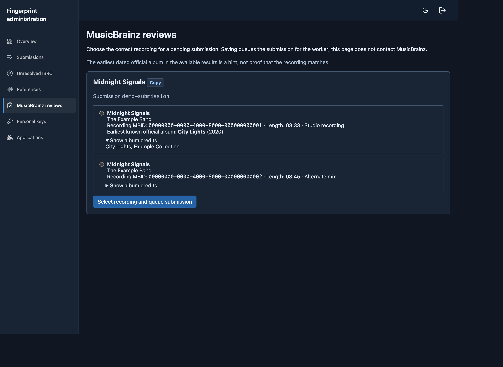
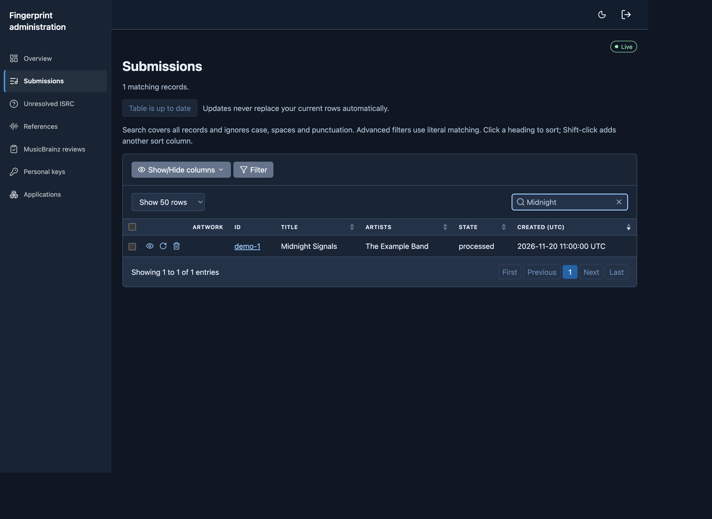
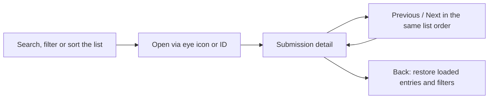
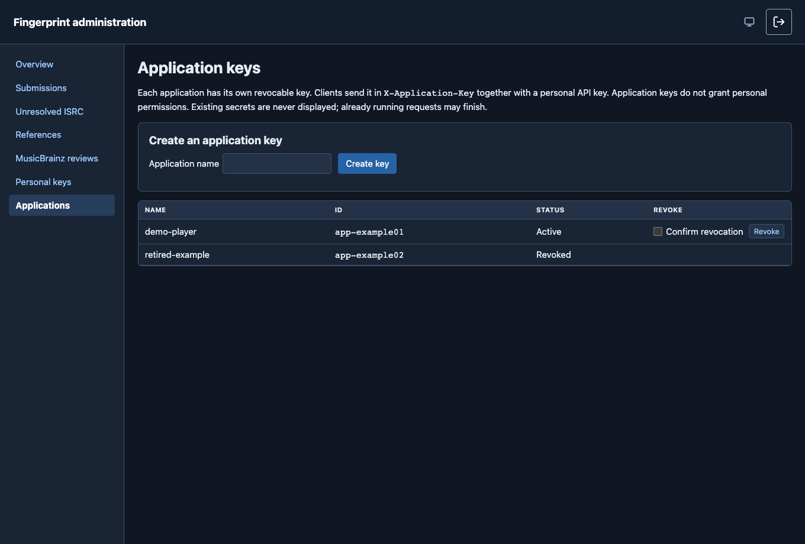

# Administrator website

[Documentation](../README.md)

Use the private Admin website to monitor the collection, review submissions
and manage API keys. For a local deployment, open
<http://127.0.0.1:8099/admin/> and sign in as **admin**.

**Jump to:** [Overview](#overview) · [Submissions](#search-and-sort) ·
[MusicBrainz reviews](#musicbrainz-reviews) · [API keys](#personal-api-keys) ·
[Setup](#local-activation)

Screenshots use synthetic records and non-functional example credentials.
Some show an earlier layout.

### Overview


| Card                          | What to look for                                             |
| ----------------------------- | ------------------------------------------------------------ |
| **Searchable recordings**     | Same count as Recognition; verified variants count once.     |
| **Acoustic references**       | Published fingerprints versus all stored fingerprints.       |
| **Database size**             | Includes indexes, excludes the SQLite WAL.                   |
| **Pending metadata**          | **View pending submissions** opens the filtered list.        |
| **Manual MusicBrainz review** | **Review candidates** opens the subset requiring a decision. |


Use **Refresh charts** for the latest saved samples. The worker saves hourly
samples for 30 days; missing hours stay blank.
The **Submission backlog** chart also shows cached covers against its right-hand
axis. Cover history starts when this measurement is enabled; earlier hours are
not reconstructed. It counts current eligible reference covers, not unique albums.

### Recognition activity

The overview counts requests reaching either fingerprint recognition endpoint,
including requests from the Recognition website and direct API clients. Requests
rejected by a gateway or the website before reaching the service are not counted.
Attempts and their outcomes are saved immediately as per-minute totals. Once a
gateway request has passed both credential checks, a separate per-minute count
also records its personal consumer and application identity when the attempt
finishes. No secret keys, audio, IP addresses or individual events are stored.
Both totals and key-linked counts are retained indefinitely. Counts begin when
their respective feature is installed; earlier activity cannot be reconstructed.

The available windows are the last hour, 24 hours, 7 days, 30 days, 365 days and all time.
The overview shows totals and an attempts chart for the selected window; open
**Recognition activity** in the menu for the totals and interval table. Both
views update when recognition counters change, at most once every five seconds,
and can also be refreshed manually. Brief interruptions are reconciled
periodically; the live indicator reports browser connection and sampling
failures. Notification transport failures are logged while periodic
reconciliation continues.
The detail view shows authenticated gateway counts by personal and application
identity for the selected period, with links to the existing revocation controls.
The Recognition website uses a shared key, so individual visitors cannot be
distinguished. Unauthenticated requests, shared-key direct deployments, missing
consumer identities and requests interrupted before completion are not attributed.
The gateway must be private and overwrite consumer headers; never expose the
backend directly to untrusted clients. Upgrade the fingerprint service before
the admin to install the identity counter table.
Windows are rounded to UTC minutes, and larger display intervals may be partial at
their edges. Failed requests include validation, authentication and service errors.
Attempts without an outcome may still be running or may have been interrupted by
a process failure. A database write error is logged and can leave the statistics
incomplete; recognition continues. The two writes per attempt may also wait for
other database writers. The SQLite/PostgreSQL migration tools preserve these totals.
The fingerprint service creates this optional table on startup, without changing
the main schema version or making an automatic upgrade backup. Older SQLite
service versions may reject the database because they do not recognize this
table, so keep a current backup and plan the rollback before upgrading.

### Artwork coverage

**Album artwork** separates two measurements:

- **Resolved lookups** is ready covers divided by ready plus missing results
  in the current cache. Pending jobs, temporary failures, expired results and
  references without a cached lookup are excluded. No completed results means
  **Not measured**, not 0%.
- **References with a cached cover** compares ready entries with all published
  references that have a recording ID and album and are eligible for lookup.
  Several acoustic variants can count separately; this is not an album count.

The panel also shows missing results, pending/temporarily unavailable requests,
expired results and references without a cached lookup. The bounded, expiring
cache does not provide a lifetime success rate or measure whether a browser
successfully displayed the image. Missing results include ambiguous albums and
searches stopped at the safety limit, not only albums without artwork. Eligible
references are partitioned into ready, missing, pending, temporarily unavailable,
expired, not-yet-looked-up and unknown-state results. The panel reports unknown
states separately when present. Background lookups run when the worker is idle,
and MusicBrainz outages or cooldowns can delay them.

### MusicBrainz reviews

On the MusicBrainz review page, each candidate shows its MusicBrainz recording
ID (MBID), not its ISRC or the server's submission ID. Candidate durations are
shown as `mm:ss` or `hh:mm:ss` for recordings of at least an hour.
Use the copy icon beside the submission title to copy its title and artist as
`title - artist`. If clipboard access is unavailable, the text is selected for
manual copying instead.
New reviews highlight the earliest dated official, non-compilation album among
the releases MusicBrainz returned for each candidate. Expand **Show album
credits** to see known non-compilation albums from the response. **Show other
releases** lists singles, compilations and releases whose type is unknown,
separately labelled as such. MusicBrainz may omit release types or return an
incomplete list, so an unknown type does not imply the release is a single.
The highlight is only a hint: it does not select a recording or change the
submitted album. Existing reviews keep their previously stored credits and
highlights; entries previously filtered out cannot be recovered from them.



### Search and sort

SQLite keeps a derived submission metadata projection for faster
search and sorting. The fingerprint service creates it during the database
upgrade, after making the usual pre-upgrade backup. Allow disk space and time
for the backup and migration; older server versions cannot open schema 10.
The admin service does not upgrade the database itself.





- **Search:** `ACDC` finds `AC/DC`. **X** clears only the search; **Filter** matches a specific field.
- **Sort:** Click a heading to change direction; Shift-click adds another column. Empty values stay last.
- **Load more:** Scroll to load more records automatically, or use **Load more**. Refresh the table if its data has changed. At most 100 submissions can be selected for one bulk action.
- **Artwork:** Both lists show cached covers in a non-sortable column. Reload to see newly cached covers. Submission details display the same cached image; published reference details can also request one and show its status.
- **Details:** **Previous / Next** can cross pages. Direct detail links have no list context. Hover over shortened values or open underlined previews to read the full text.
- **Retry and delete:** Row and bulk actions require confirmation. Deleting a submission does **not** delete its acoustic reference. References are read-only.

<details>
<summary>Submission and reference rules</summary>

- The **Reference ID** links a submission to a stored acoustic fingerprint. It is not a MusicBrainz ID and can be empty before a submission is processed.
- **Unresolved ISRC submissions** includes retained entries with an ISRC whose state is not `processed`. It does not certify ISRC validity or show how a processed recording was verified.
- A pending review preserves unresolved entries and their completed recheck counts. Normal housekeeping is separate.
- Queued and processing entries cannot be changed. Retry is limited to failed or unresolved submissions, respects admission budgets and resets attempts but not completed rechecks.
- Tables load records in batches. Narrow the search or filters to reach records beyond the supported offset. Raw fingerprints are never returned. Reviews do not send data back to MusicBrainz; worker cooldown is not shown in Admin.

</details>

### Personal API keys

Choose read, upload or both. To revoke a personal or application key, select
**Confirm revocation** in its row, then **Revoke**.


**Save the secret at creation.** It will not appear in the list again.


### Application keys

Clients send **both**: the personal key in `X-API-Key`, and the application
token in `X-Application-Key`. Revoked applications remain visible for audit.




## Application-key registry upgrade

Deploy the new API code to **all replicas before issuing registry keys**.
Gateway-enabled service startup creates the independent version-1
`application_key_schema` and `application_keys` tables transactionally under
the existing migration/write lock. Repeated startup preserves credentials.
This does not change the fingerprint format version or alter existing rows.
The admin only validates this registry; it never creates or migrates it.

The existing `FP_APPLICATION_KEY` stays valid and is shown as a legacy
environment credential, without revealing its value. It cannot be revoked
through this page. After moving clients to registry keys, rotate that variable
consistently on backend services to retire its old value; removing it is not
currently supported. Restart the admin with the same configuration too.

Active registry keys are checked against the database on each request without
a positive-authentication cache, so revocation affects the next check on every
updated replica. A database error fails registry authentication with HTTP 503,
not legacy access. Already authenticated requests may finish. Authentication
logs use the opaque `app-<id>` identity, never the secret or its hash.

Back up the registry with the database. The SQLite/PostgreSQL migration tools
carry the registry and its revocation state. Personal gateway keys are separate
and require an etcd backup.
Rolling back to pre-registry API code similarly disables registry keys; it
does not delete them.

## Live updates

The desktop shell keeps the earlier Tabler-style dark sidebar with its title
and icons, with theme and sign-out controls in the header to the right.
On mobile, the title stays in the header and the navigation collapses behind
the menu button. Dashboard, table and form behavior is unchanged.

Dashboard counts, chart values and database size use the browser's default
number format, including thousands and decimal separators.

The overview updates automatically. Tables keep your current rows until you
choose **Newer data available - refresh**. Refresh keeps search, sorting,
page and scroll position but clears selected rows.

<details>
<summary>Search timing, live updates and troubleshooting</summary>

Search runs across the entire dataset after a 350 ms pause, or immediately
with Enter. It ignores case and can match without punctuation; punctuation-only
queries and advanced filters retain literal matching. Metadata searches can
take several seconds on larger collections. A failed request does not replace
the current rows with an empty result.

The overview receives counts, database size and worker availability through an
authenticated Server-Sent Events (SSE) connection. One shared sampler checks
the database every five seconds while browsers are connected, regardless of
how many tabs are open. Slow clients receive the latest snapshot rather than
an ever-growing event queue. Connection and database failures are shown
explicitly; displayed numbers must not be treated as fresh during an outage.
On the overview and database table pages, the connection status shows the last
successful check or explains why the data may be stale. Key-management pages
do not open a live database stream.

Table notices are advisory: PostgreSQL uses asynchronous per-table write
counters plus lifecycle/reference counts, not expensive metadata or landmark
scans. Metadata-only updates are detected even when row counts stay the same,
but PostgreSQL statistics can lag and unrelated writes can trigger a notice.
`track_counts=on` is required. This adds no schema changes or database triggers.
SQLite uses a persistent connection's `PRAGMA data_version`; any external
database commit can mark both tables as changed.

The SSE stream rechecks session validity on each update and at least every ten
seconds; logout or expiry ends updates. The live badge shows the connection
state. Hover over the badge or open its popover for details, including the last
update time when connected; the details do not shift the page content.
All visible Admin pages also check the session every 15 seconds
and when the tab becomes visible again. A connection failure alone does not
sign you out. The browser reconnects automatically
after a connection failure. A service restart invalidates sessions and requires
signing in again. Reverse proxies must disable buffering for `/admin/events`
and allow long-lived responses.

</details>

## Local activation

Install `.[admin]` for native use, or add `compose.admin.yaml` **after** the
existing gateway/PostgreSQL Compose files. The optional image build installs
the admin extra and builds the frontend; ordinary API/worker images do not need
the admin extra. For a native source checkout, use Node.js 24 and run
`pnpm install --frozen-lockfile` and `pnpm build` in `admin-frontend` before
starting the admin or packaging a Python distribution.

For SQLite, append `compose.sqlite-admin.yaml` after `compose.admin.yaml` and
mount the same database directory into both services. When also using
`compose.local-gateway.yaml`, append `compose.local-sqlite-admin.yaml` to
share its bind mount and user. Other bind mounts require an equivalent admin
mount. Set `FP_SQLITE_DATABASE` if the database filename differs from the
default `/data/fingerprints.db`. The database and its directory must be writable by both
processes, including the WAL/SHM files. Run exactly one SQLite API process,
which also runs the worker. `FP_WORKER_HEALTH_URL` must point to its private
`/health` endpoint; an unreachable or unhealthy worker is shown as unavailable.

Set these additional values in a private environment file outside version
control, with owner-only permissions:

- `FP_ADMIN_KEY`: an independently generated URL-safe secret of at least
  32 characters. This is the password for username **admin**.
- `FP_ADMIN_POSTGRES_DSN` (PostgreSQL only): a connection string reachable from the
  admin container, using the existing service database role, not the database
  superuser. Native runs use `FP_POSTGRES_DSN` instead.
- `FP_GATEWAY_ADMIN_KEY`: the existing private APISIX administration key.

Reuse the existing internal read/upload/application keys and schema setting;
set `FP_GATEWAY_ENABLED=true` when providing the application key (already set
by the Compose overlay).
Set `FP_QUEUE_LIMIT` and `FP_QUEUE_BYTES_LIMIT` to the **same values as the
ingestion service**, so manual retries enforce its queue budgets too.

For example, append the overlay to your normal Compose command:

```sh
docker compose --env-file /private/path/gateway.env \
  --env-file /private/path/admin.env \
  -f compose.gateway.yaml -f /private/path/postgres.compose.yaml \
  -f compose.admin.yaml up -d --build --no-deps admin
```

Keep any existing project name and local overlays in that command. The admin
service joins the backend, private administration and outbound networks and publishes
only `127.0.0.1:8099`. It does not start a worker, acquire API ownership, create
tables or apply migrations. The database and gateway must already be running.
Open <http://127.0.0.1:8099/admin/> and sign in as **admin**.
The theme button cycles through System, Light and Dark. System is the default
and follows changes to the device's appearance. Manual choices are remembered.
The standalone Vite preview serves the frontend only. Use the actual Admin
service URL for sign-in and API-backed pages; the preview has no session API.

Use **one admin process/replica**: sessions and login admission are held in that
process. Login is capped at ten attempts per minute across the service.
Sessions expire after one hour, are revoked on logout, and are invalidated by
an admin restart. Cookies are HttpOnly/SameSite=Strict; the login secret is not
stored in them. State-changing requests require POST and a same-origin Origin
header. Responses are marked `no-store`.

The Admin container logs audit events under `fingerprint_server.admin.audit`.
Use `docker logs <admin-container>` and filter by that logger name to see login,
logout, review, queue and credential write outcomes, including rejected requests.
Entries carry an event name, an action where applicable, the authenticated Admin
role if known, and an HTTP status. They do not include passwords, keys, cookies,
request bodies, or query strings. The current shared Admin login cannot identify
individual operators. Retention follows the container's log configuration;
forward these logs separately if they must survive container replacement.

## Future remote access

Do not expose APISIX's administration port or etcd. Prefer access through a VPN;
otherwise use a dedicated HTTPS reverse proxy/hostname with additional access
control, and set `FP_ADMIN_COOKIE_SECURE=true`. Preserve the original Host and
configure Uvicorn's trusted proxy handling explicitly so origin validation sees
the correct HTTPS origin. Do not trust forwarded headers from arbitrary peers.

The administration service holds privileged database and APISIX credentials.
It is not a public multi-tenant portal. Public operation needs deployment-specific
access control and edge request limits; adding OIDC later belongs in the auth
provider/proxy, without replacing the tables or data adapters.

After changing the frontend or admin API, rerun the admin tests and browser
checks for authentication, filtering, confirmed actions and one-time key display.
