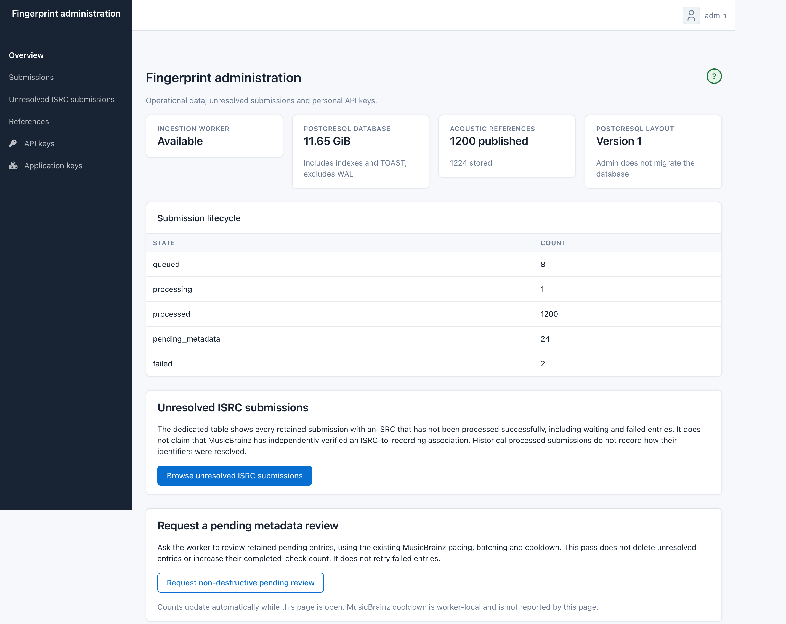
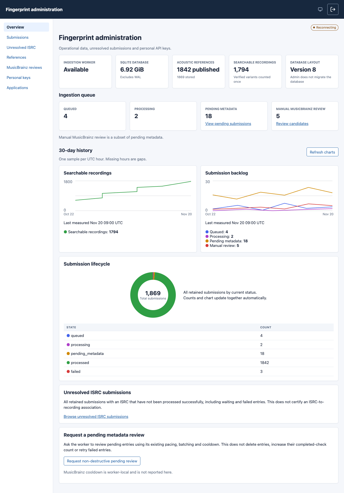
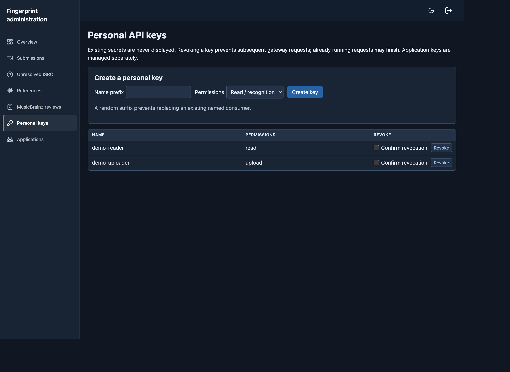
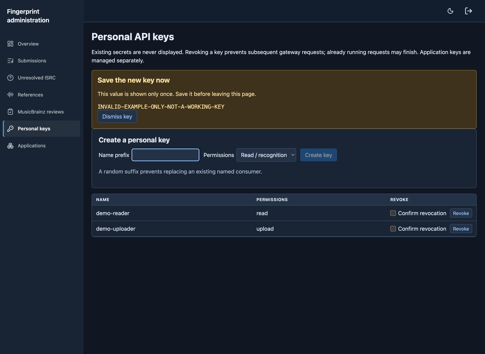
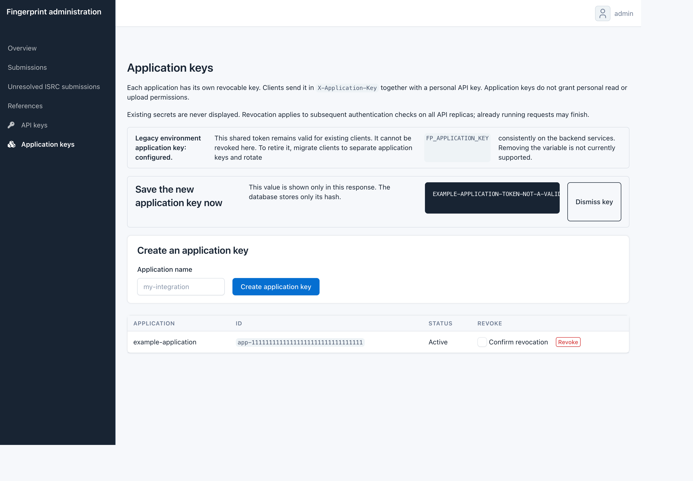

# Administrator website

[Documentation](../README.md)

The optional admin service serves a Vue 3 frontend and a private, same-origin
JSON API, separate from the public fingerprint API.
It adds searchable, server-paginated metadata tables without introducing ORM
models or changing the database schema. It supports SQLite and PostgreSQL with
APISIX.

## What it provides

- Database size (including indexes, excluding WAL), layout version,
  worker availability, reference counts and submission lifecycle counts.
- Searchable submissions and references, detail views, sortable columns and
  advanced text filters. Tables show at most 100 records per page and scroll
  within the page; raw fingerprint documents are never returned.
- An **Unresolved ISRC submissions** table: all retained submissions with an
  ISRC whose state is not `processed`, including waiting and failed entries.
  This is a processing-state view, not a certificate of ISRC validity.
  Historical processed records do not store whether resolution was based on
  an ISRC association or a strict metadata match, so the UI cannot reconstruct
  that distinction.
- A non-destructive pending review using the existing worker controls.
  This preserves unresolved entries and does not increase their completed
  pending-check count. Normal housekeeping remains a separate operation.
- Confirmed individual/bulk retries and submission deletions. Queued and
  processing jobs cannot be changed. Retry is limited to failed/unresolved
  records, respects shared admission budgets, resets attempt counts and
  preserves completed pending-check counts. Deleting a submission retains its
  acoustic reference and landmarks; it is **not** a reference purge.
- Personal APISIX key creation/revocation. Stored secrets are never displayed;
  a newly generated secret is shown only in its creation response. Names have
  a random suffix to avoid replacing an existing named consumer through
  APISIX's upsert endpoint.
- Separate **Application keys** page for creating and revoking named application
  credentials. Secrets appear once on creation; the database stores only SHA-256
  hashes of the randomly generated keys. Revoked identities remain listed for
  audit purposes. Every application still needs a personal key for permissions.
  Internal scope and gateway/admin credentials are not managed here.

MusicBrainz cooldown is worker-local and is not reported by this service.
No data is submitted back to MusicBrainz.

## A quick look

After signing in, use the left sidebar to switch between admin pages. On narrow
screens, use the three-line menu icon above the page content to open the
navigation and the **X** icon to close it.
Use the moon or sun icon in the header to switch to dark or light mode.
The admin starts in light mode and remembers your choice in this browser.

Actions such as copying a track title or refreshing the charts show a short
notification. Manual copy instructions and one-time keys stay visible so
you have time to use them.

These screenshots show the previous layout and use synthetic example records and key names, not a live
installation's private data. Creation screenshots show clearly labelled,
non-functional example credentials only.

### Overview

The overview shows worker availability, database size and live ingestion counts:
queued, processing, pending metadata and awaiting manual MusicBrainz review.
Select **View pending submissions** below the **Pending metadata** count to
open the submissions list with that status filter. The **Manual MusicBrainz
review** card links to **Review candidates** in the same position. Manual
review is a subset of pending metadata. The connection indicator shows whether
live data is current.

The history charts show searchable recordings (not individual fingerprint
references) and the submission backlog. The worker stores one sample per UTC
hour and keeps the most recent 30 days. History begins with the first saved
sample; missing hours stay blank. Use **Refresh charts** to load the latest
saved samples without reloading the overview.
The updated server creates the history table on startup without rewriting
existing fingerprints. Deploy the updated worker to start collection.





### MusicBrainz reviews

On the MusicBrainz review page, each candidate shows its MusicBrainz recording
ID (MBID), not its ISRC or the server's submission ID. Candidate durations are
shown as `mm:ss` or `hh:mm:ss` for recordings of at least an hour.
Use the copy icon beside the submission title to copy its title and artist as
`title - artist`. If clipboard access is unavailable, the text is selected for
manual copying instead.
New reviews highlight the earliest dated official album among the releases
MusicBrainz returned for each candidate. Expand **Show album credits** to see
the full list from the response. The highlight is only a hint: it does not
select a recording or change the submitted album. Older reviews without dates
still show their album credits but have no highlight.


### Search and sort

Searching for `ACDC` also finds `AC/DC`. The result count confirms that the
filter has finished; column headings control sorting. The **X** in the search
field clears the search without changing advanced filters or sorting. Use **Show/Hide columns**
to adjust the visible fields without changing the results, or **Filter** for
literal matching. Wider tables scroll horizontally without moving the page
controls. Long values are shortened to keep rows compact. Hover over a cell to
see its full value, or click or tap an underlined preview to open it. The ID
link opens the full record.
Use the eye icon to open a record. In submission lists, the retry and delete
icons act on that row only and require confirmation. References are read-only.


### Personal API keys

Issue personal keys with read, upload or combined permissions. To revoke a
personal or application key, select **Confirm revocation** in that key's row
and click **Revoke**. Existing secret values are never displayed.
Like the data tables, key tables scroll horizontally inside their own area
when the columns do not fit; the rest of the page stays in place.



After creation, save the personal key before leaving or dismissing the page:
its value will not appear in the list again.



### Application keys

Applications have separate revocable keys, in addition to the personal key
that grants permissions. The legacy environment token is identified but not
revealed, and revoked application identities remain visible.


The application token is also shown only once. Clients send this value in
`X-Application-Key`, alongside their personal key in `X-API-Key`. The visible
example below is deliberately not a valid token.



## Application-key registry upgrade

Deploy the new API code to **all replicas before issuing registry keys**.
Gateway-enabled service startup creates the independent version-1
`application_key_schema` and `application_keys` tables transactionally under
the existing migration/write lock. Repeated startup preserves credentials.
This does not change the fingerprint format version or alter existing rows.
The admin only validates this registry; it never creates or migrates it.

The existing `FP_APPLICATION_KEY` stays valid and is shown as a legacy
environment credential, without revealing its value. It cannot be revoked
through this page. After moving clients to registry keys, rotate that variable
consistently on backend services to retire its old value; removing it is not
currently supported. Restart the admin with the same configuration too.

Active registry keys are checked against the database on each request without
a positive-authentication cache, so revocation affects the next check on every
updated replica. A database error fails registry authentication with HTTP 503,
not legacy access. Already authenticated requests may finish. Authentication
logs use the opaque `app-<id>` identity, never the secret or its hash.

Back up the registry with the database. The SQLite/PostgreSQL migration tools
carry the registry and its revocation state. Personal gateway keys are separate
and require an etcd backup.
Rolling back to pre-registry API code similarly disables registry keys; it
does not delete them.

## Live updates

Table search filters the entire dataset on the server, not just the visible
page. Typing, pasting and clearing the search field apply after a 350 ms pause;
Enter applies immediately. Search is case-insensitive and also matches with
spaces and punctuation removed, so `ACDC` finds `AC/DC`. Punctuation-only
queries still use literal matching rather than matching everything. Advanced
field filters retain their literal matching rules.
Click column headings to toggle ascending/descending order, or Shift-click
for multiple sort columns. Numeric counts and verification versions sort
numerically. Selection/action and hidden metadata columns are not sortable.
The query status explicitly shows when a search or table load is running,
then shows the matching-record count. Previous rows stay visible until the
response arrives; a failed request is marked as an error, not an empty result.
Metadata searches still read the stored submission documents and can take
several seconds on larger collections.

The overview receives counts, database size and worker availability through an
authenticated Server-Sent Events (SSE) connection. One shared sampler checks
the database every five seconds while browsers are connected, regardless of
how many tabs are open. Slow clients receive the latest snapshot rather than
an ever-growing event queue. Connection and database failures are shown
explicitly; displayed numbers must not be treated as fresh during an outage.
On the overview and database table pages, the connection status shows the last
successful check or explains why the data may be stale. Key-management pages
do not open a live database stream.

Submission, unresolved-ISRC and reference tables keep their rows, filters,
sorting, selection and scroll position when changes arrive. A **Newer data
available - refresh** button lets the operator reload rows explicitly, keeping
the current search, sort, page and scroll position. That explicit refresh
clears selected rows to avoid applying actions to an outdated selection.
API-key pages are not part of this database stream.

Table notices are advisory: PostgreSQL uses asynchronous per-table write
counters plus lifecycle/reference counts, not expensive metadata or landmark
scans. Metadata-only updates are detected even when row counts stay the same,
but PostgreSQL statistics can lag and unrelated writes can trigger a notice.
`track_counts=on` is required. This adds no schema changes or database triggers.
SQLite uses a persistent connection's `PRAGMA data_version`; any external
database commit can mark both tables as changed.

The SSE stream rechecks session validity on each update and at least every ten
seconds; logout or expiry ends updates. The live badge shows the connection
state. Hover over the badge or open its popover for details, including the last
update time when connected; the details do not shift the page content.
All visible Admin pages also check the session every 15 seconds
and when the tab becomes visible again. A connection failure alone does not
sign you out. The browser reconnects automatically
after a connection failure. A service restart invalidates sessions and requires
signing in again. Reverse proxies must disable buffering for `/admin/events`
and allow long-lived responses.

## Local activation

Install `.[admin]` for native use, or add `compose.admin.yaml` **after** the
existing gateway/PostgreSQL Compose files. The optional image build installs
the admin extra and builds the frontend; ordinary API/worker images do not need
the admin extra. For a native source checkout, use Node.js 24 and run
`pnpm install --frozen-lockfile` and `pnpm build` in `admin-frontend` before
starting the admin or packaging a Python distribution.

For SQLite, append `compose.sqlite-admin.yaml` after `compose.admin.yaml` and
mount the same database directory into both services. When also using
`compose.local-gateway.yaml`, append `compose.local-sqlite-admin.yaml` to
share its bind mount and user. Other bind mounts require an equivalent admin
mount. Set `FP_SQLITE_DATABASE` if the database filename differs from the
default `/data/fingerprints.db`. The database and its directory must be writable by both
processes, including the WAL/SHM files. Run exactly one SQLite API process,
which also runs the worker. `FP_WORKER_HEALTH_URL` must point to its private
`/health` endpoint; an unreachable or unhealthy worker is shown as unavailable.

Set these additional values in a private environment file outside version
control, with owner-only permissions:

- `FP_ADMIN_KEY`: an independently generated URL-safe secret of at least
  32 characters. This is the password for username **admin**.
- `FP_ADMIN_POSTGRES_DSN` (PostgreSQL only): a connection string reachable from the
  admin container, using the existing service database role, not the database
  superuser. Native runs use `FP_POSTGRES_DSN` instead.
- `FP_GATEWAY_ADMIN_KEY`: the existing private APISIX administration key.

Reuse the existing internal read/upload/application keys and schema setting;
set `FP_GATEWAY_ENABLED=true` when providing the application key (already set
by the Compose overlay).
Set `FP_QUEUE_LIMIT` and `FP_QUEUE_BYTES_LIMIT` to the **same values as the
ingestion service**, so manual retries enforce its queue budgets too.

For example, append the overlay to your normal Compose command:

```sh
docker compose --env-file /private/path/gateway.env \
  --env-file /private/path/admin.env \
  -f compose.gateway.yaml -f /private/path/postgres.compose.yaml \
  -f compose.admin.yaml up -d --build --no-deps admin
```

Keep any existing project name and local overlays in that command. The admin
service joins the backend, private administration and outbound networks and publishes
only `127.0.0.1:8099`. It does not start a worker, acquire API ownership, create
tables or apply migrations. The database and gateway must already be running.
Open <http://127.0.0.1:8099/admin/> and sign in as **admin**.
The theme button cycles through System, Light and Dark. System is the default
and follows changes to the device's appearance. Manual choices are remembered.
The standalone Vite preview serves the frontend only. Use the actual Admin
service URL for sign-in and API-backed pages; the preview has no session API.

Use **one admin process/replica**: sessions and login admission are held in that
process. Login is capped at ten attempts per minute across the service.
Sessions expire after one hour, are revoked on logout, and are invalidated by
an admin restart. Cookies are HttpOnly/SameSite=Strict; the login secret is not
stored in them. State-changing requests require POST and a same-origin Origin
header. Responses are marked `no-store`.

The Admin container logs audit events under `fingerprint_server.admin.audit`.
Use `docker logs <admin-container>` and filter by that logger name to see login,
logout, review, queue and credential write outcomes, including rejected requests.
Entries carry an event name, an action where applicable, the authenticated Admin
role if known, and an HTTP status. They do not include passwords, keys, cookies,
request bodies, or query strings. The current shared Admin login cannot identify
individual operators. Retention follows the container's log configuration;
forward these logs separately if they must survive container replacement.

## Future remote access

Do not expose APISIX's administration port or etcd. Prefer access through a VPN;
otherwise use a dedicated HTTPS reverse proxy/hostname with additional access
control, and set `FP_ADMIN_COOKIE_SECURE=true`. Preserve the original Host and
configure Uvicorn's trusted proxy handling explicitly so origin validation sees
the correct HTTPS origin. Do not trust forwarded headers from arbitrary peers.

The administration service holds privileged database and APISIX credentials.
It is not a public multi-tenant portal. Public operation needs deployment-specific
access control and edge request limits; adding OIDC later belongs in the auth
provider/proxy, without replacing the tables or data adapters.

After changing the frontend or admin API, rerun the admin tests and browser
checks for authentication, filtering, confirmed actions and one-time key display.
