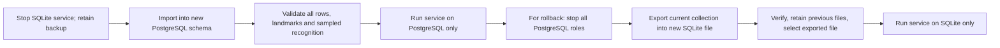

# Moving between SQLite and PostgreSQL

[Home](../../README.md) · [Documentation](../README.md) · [Deployment](deployment.md)

Only the fingerprint service database is moved. Music Assistant's own library
database is unrelated and remains unchanged. SQLite schema 8 and PostgreSQL
formats 1 and 2 store the same collection using different physical layouts.

## PostgreSQL compact layout and rollback

**Experimental; not recommended for deployment.** The full-collection rehearsal
on 2026-11-17 passed data and runtime checks but increased landmark storage from
6,704,136,192 to 8,410,185,728 bytes (+25.4%). The fixed block boundaries fragment
posting lists too heavily. The running local service remains on format 1;
the format-2 implementation and commands below are retained for investigation,
not as a space-saving upgrade recommendation.

Format 1 stores a row per landmark. Format 2 stores sorted, paired arrays of
reference IDs and offsets, grouped by the complete 80-bit hash. Reference-ID
blocks of 32 and offset blocks of 1,024 limit each posting to at most 32,768
unique pairs, independently of catalogue growth. A primary key, array checks
and reference-integrity triggers enforce valid blocks, unique sorted pairs
and existing reference IDs. The runtime keeps its schema-wide writer lock;
two APIs can still read while the single worker writes.

This bounded layout differs from the unbounded experimental layout. Do not
assume the experimental 69% saving applies to it. Measure the actual migrated
collection and recognition behavior before selecting it.

New databases and SQLite imports initially use format 1. Upgrades are explicit
and offline, not an automatic startup operation:

```sh
# Make and verify a PostgreSQL backup, then stop both APIs and the worker.
uv run --no-sync python scripts/migrate_postgres_layout.py \
  --schema fingerprints --target 2
```

The migration requires all API, worker and write ownership locks, converts
every landmark, compares a canonical binary SHA-256 checksum and updates the
format version in one transaction. Other tables and identity sequences are
unchanged. A failed conversion rolls back; rerunning the requested format is
a no-op. Allow space for both layouts, sorting and WAL during conversion.
Run `VACUUM (ANALYZE)` afterward before measuring performance.

To return to format 1 while preserving changes made since the upgrade:

```sh
# Stop every API and worker again; use the current database, not an old backup.
uv run --no-sync python scripts/migrate_postgres_layout.py \
  --schema fingerprints --target 1
```

The reverse conversion verifies every landmark before replacing the posting
lists. Both formats support the SQLite exporter below. The format-2 `landmarks`
view is a read-compatible decoded representation, not a writable table.
Start only runtime versions supporting the selected format. Preserve the
database backup and previous container image until authenticated gateway
requests, worker health and sampled recognition have passed.

## One writable database

Stop ingestion and all API/worker processes before the final transfer in either
direction. Do not write to both copies. Keep the old database and a verified
backup until the destination has been checked and the rollback window has ended.



Changing the backend setting does not copy data. The migration tools never
change the running deployment, overwrite an existing destination, or merge
independently modified databases. Set private libpq connection variables
(`PGHOST`, `PGPORT`, `PGDATABASE`, `PGUSER`, `PGPASSFILE`) before these commands;
do not place passwords in shell arguments. Install the PostgreSQL extra for
native migration commands.

## SQLite to PostgreSQL

```sh
uv run --no-sync python scripts/migrate_sqlite_to_postgres.py \
  /private/path/fingerprints.db --schema fingerprints
```

The importer creates a consistent SQLite snapshot, checks integrity and foreign
keys, and requires a **new** PostgreSQL schema. It compares all metadata fields,
preserves queue order, verifies every landmark with a binary SHA-256 checksum
and row count, creates constraints/indexes and resets identity sequences. A
failure rolls back the new schema. Existing source files are not changed.
Run PostgreSQL `VACUUM (ANALYZE)` on the imported tables before measuring lookup
performance. Keep the same verification, housekeeping and queue settings on
the new runtime; changing them can intentionally change recovery behavior.
When present, the application-key registry, artwork requests, MusicBrainz
reviews and hourly administration history are transferred too. Gateway
personal keys and configuration are stored separately and require their own
backups.

See the [measured import/runtime rehearsal](../benchmarks/postgresql-runtime.md).
PostgreSQL needs substantially more disk space than occupied SQLite pages,
plus WAL, temporary files and backups.

## PostgreSQL back to SQLite

```sh
# Stop every API process and the single worker first.
uv run --no-sync python scripts/migrate_postgres_to_sqlite.py \
  /private/path/fingerprints-returned.db --schema fingerprints
```

The exporter takes exclusive API/worker/writer advisory locks before opening
a repeatable-read, read-only snapshot. It rejects active service roles,
including opt-in API replicas, and prevents another role starting during the
export. Use a dedicated direct or session-mode PostgreSQL connection. These
locks coordinate this service, not unrelated administrators issuing SQL; do
not modify the source manually during export.

All reference IDs/keys, documents, publication/verification fields, metadata,
landmarks, cache entries, service-state values and queue/retry state are copied.
PostgreSQL `queue_order` becomes SQLite's submission `rowid`, preserving FIFO
ties and gaps. New PostgreSQL records and deletions are reflected in the result.
PostgreSQL-only rate/ownership state is retained; SQLite does not interpret it.
The application-key registry, artwork requests, MusicBrainz reviews and hourly
administration history are retained when present. Gateway personal keys and
configuration are separate from this database and are not included in the export.
To use the standalone administration service with SQLite, share the same
database directory and configure its worker health URL as described in the
[administrator guide](admin.md).

Metadata is compared field by field. Every landmark is checked against the
source-stream SHA-256 digest and row count. The exporter then builds SQLite's
secondary indexes, checks integrity and foreign keys, sets schema 8 and analyzes
the result. It does **not** run worker recovery or rewrite processing states;
ordinary SQLite startup performs its existing recovery afterward.

The output is built privately in the destination directory, then published
without overwriting an existing file or symlink. Failure removes the partial
file. Allow disk space and time for a complete copy; this is not an incremental
sync or an online hot standby.

Before starting SQLite:

1. Compare statistics, availability and sampled recognition against PostgreSQL.
2. Keep PostgreSQL stopped and preserve the original SQLite file and backups.
3. Configure `FP_DATABASE_BACKEND=sqlite`, `FP_SERVICE_ROLE=all`,
   `FP_API_REPLICAS_ENABLED=false` and point `FP_DATABASE` at the new exported file.
   Ensure its owner can write it and its parent directory for WAL/SHM files.
4. Start exactly one SQLite service process and check health, queue recovery,
   authenticated requests and recognition through the gateway.

Do not replace an SQLite file while any process still has it or its WAL/SHM
files open. Restoring only the pre-PostgreSQL backup discards all later writes;
use the **current PostgreSQL export** when those writes must be retained.

## Reproducible checks

```sh
FP_TEST_POSTGRES=1 uv run --no-sync pytest -q \
  tests/test_postgres_migration.py tests/test_postgres_reverse_migration.py \
  tests/test_postgres_runtime_trial.py

uv run --no-sync python scripts/postgres_runtime_trial.py \
  /path/to/fingerprints.db --samples 50 --repetitions 1 \
  --report /private/path/roundtrip-result.json
```

The full-collection trial uses a read-only SQLite backup and disposable
PostgreSQL, adds synthetic post-import data and exercises cleanup, then exports
back to SQLite and compares runtime results. It also checks PostgreSQL source
content is unchanged by export and verifies `pg_dump`/restore independently.
Nothing in this rehearsal selects a new backend for the running service.

### Full-collection reverse-export measurement

The 2026-11-17 local rehearsal imported 56,915,996 landmarks from 838 references.
After synthetic ingestion and cleanup, the reverse exporter verified
**56,920,886 landmarks, 839 references and 922 submissions**, including all cache
and service-state fields. The new SQLite file occupied **3,468,591,104 bytes**
(3.23 GiB); export, secondary-index construction and integrity checks took
**402.5 seconds**. This excludes subsequent runtime comparisons.

All 50 sampled recognition outcomes agreed between the returned SQLite file
and PostgreSQL: 46 ranked candidate results and four explicit candidate-limit
errors. Statistics and availability for 100 reference-derived items also
agreed, and the PostgreSQL source content was unchanged. The separate
PostgreSQL dump/restore passed every application-table checksum and all 50
recognition samples. These are local functional measurements, not guaranteed
rollback durations on another host.
