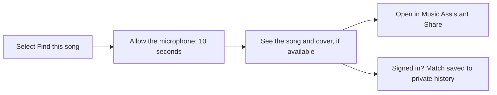
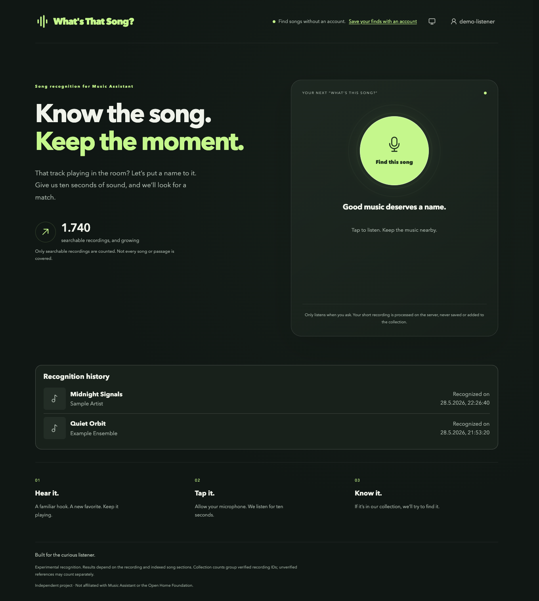

# What's That Song? — public microphone recognition app

[Home](../../README.md) · [Documentation](../README.md)

What's That Song? is an independent song recognition app for Music Assistant.
You don't need an account or API key to identify a song.

**Jump to:** [Sharing](#open-in-music-assistant-share) · [Artwork](#album-artwork) ·
[Private history](#optional-private-history) · [Setup](#configuration-and-local-development)





The theme icon switches between System, Light and Dark. The footer links back
to this guide.

## What stays on the server

**Microphone audio is not saved or added to the collection.** The device name
stays in your browser. The collection counter shows searchable recordings,
not the number of submitted fingerprints.

<details>
<summary>Audio processing, privacy and availability checks</summary>

The browser records ten seconds of mono PCM, stops the microphone and sends the
recording to this website's own backend. The backend attaches a dedicated read-only
personal key and application token and calls the existing fingerprint API.
Landmark extraction, resampling and matching still run on the fingerprint API
server. Neither credential is returned to the browser or accepted from browser
headers. The public service has no database credentials and no upload/admin routes.
The page displays the active audio track's device name after capture starts.
The name stays in the browser and is not sent to the server.

Microphone audio is transient: it is not saved, indexed, or used to grow the
collection. Recognition results expose only title, artists and album. Internal
reference IDs, match scores, retained metadata and upstream error details stay
private. The authenticated recognition API remains available for clients.

API diagnostics log capture duration, sample rate, RMS/peak levels, landmark and
candidate counts, aggregate match evidence and the acceptance decision. They do
not log audio, fingerprint hashes, reference IDs or song metadata. These figures
help distinguish capture problems from an insufficient acoustic match without
keeping the recording.

The counter uses `recordings.total` from the authenticated statistics endpoint:
logical **searchable recordings**, not acoustic variants or queued submissions.
Verified recording IDs are grouped; unverified references may count separately.
It is not a promise that every passage or every song will be recognized.
The backend caches the count for up to 60 seconds. The browser loads it on page
opening and refreshes every 60 seconds while visible, including after a failed
request. Refreshes pause in hidden tabs and resume immediately when the page
becomes visible again. Failed refreshes are explicit and are not displayed as zero.
While the server is already refreshing the count, the browser honors its short
retry delay up to five times before reporting that the count is unavailable.
Rate-limited requests also keep the loading indicator while waiting for the
server's retry delay (up to 60 seconds); switching tabs does not bypass this wait.
While the first count is loading, the page shows four to ten rolling digits, or “Loading…”
with reduced motion. A dash means no valid count is available. Once a count is
available, it stays visible during refresh.

The microphone button stays disabled until the recognition service is available.
If the backend or database becomes unavailable, the page displays a temporary
unavailability/maintenance message and checks again every ten seconds while
visible. It enables the button automatically when service returns. The backend
shares a ten-second health-check cache between visitors; neither credentials nor
database details are exposed to the browser.

</details>

## Open in Music Assistant Share

The current match offers a labeled **Open in Music Assistant Share** link. History
entries with a title show the [Music Assistant logomark](https://brands.openhomefoundation.org/music-assistant/#logomark)
at the right of each row. Hover or focus it to see the link label. Both links
open Music Assistant Share in a new tab.
Sharing works without a cover. Links carry the song details and, when loaded,
the public cover URL, but no provider links, fingerprints, account data or dates.

## Album artwork

The song appears immediately; the cover can arrive later. If no cover loads,
the record illustration stays in place. The browser loads images directly from
Cover Art Archive or archive.org, which receives the browser's IP address.

For a local deployment with Admin and Recognition, append
[compose.artwork-cache.yaml](../../compose.artwork-cache.yaml) after the other
overlays and rebuild both services. They then share a separate, disposable
image cache. The first view still fetches the image from the archive;
subsequent views can serve it locally. When local delivery fails, the browser
falls back to the public archive URL and the archive can see the browser's IP
address. Share links keep the public archive URL. Up to 256 images (512 KiB
each, about 128 MiB of image data plus SQLite overhead) are eligible to be
served for seven days. The cache need not be backed up and does not change
the fingerprint or history database.

<details>
<summary>How the worker finds and caches covers</summary>

Successful matches offer a separate, short-lived artwork URL on this service.
The song card appears immediately, with a decorative record placeholder in the
reserved cover area while artwork is loading
or when artwork is absent or unavailable. Loading the image does not move the title.
Artwork is polled
for up to about a minute. A later recognition cancels the previous cover display.
The first three pending responses are retried after one second rather than three,
so fast worker lookups do not incur a full three-second polling delay. Further
pending responses use three-second intervals to limit backend traffic.
The public token expires after ten minutes and does not reveal the reference ID.

The existing ingestion worker resolves the recording's releases through its
shared, throttled MusicBrainz client. It compares the supplied album name with
release and release-group titles and requires one unique group. If that group
has no front cover, it checks up to three matching releases in the group. This is representative
album art; known parenthesized edition labels such as "Deluxe Edition" and
"Deluxe Version" are ignored
when comparing album names. Live/version titles are not stripped. This is
not a guarantee of the exact edition. Ambiguous albums or absent
covers leave the text result intact. Enable MusicBrainz and configure its contact
address on the worker as for metadata verification; no additional key is needed.

Cover Art Archive is queried at most once per 1.1 seconds with a HEAD request.
The worker reads only the redirect, never the image bytes. Group-level cover
and release-level results, including confirmed absence, use the existing seven-day
enrichment cache. Per-reference covers expire after 30 days; new negative results
expire after seven days. Temporary failures are reported
separately, expire after a minute, and are not cached as missing covers.

The browser loads a cover directly from the archive over HTTPS without a referrer;
this makes its IP address visible to the image host. Only Cover Art Archive and
archive.org image hosts are permitted by validation and the page's image policy.
Recognition credentials are never sent to them.

</details>

### Additive database migration

<details>
<summary>Edition matching backlog, schema and rollout notes</summary>

Startup installs the independently versioned artwork extension (version 1), like
the application credential registry: `artwork_requests` plus the `artwork_schema`
entry in existing service state. Installation is transactional and idempotent on
SQLite and PostgreSQL. Existing reference rows, fingerprint formats and core
database versions are unchanged; there is no rescan or bulk MusicBrainz lookup.
When the worker has no submissions or requested artwork to process, it prepares
at most one published reference every 15 seconds. It caches the URL or lookup
result, not image files. This stops at 3,072 entries so that on-demand lookups
have room in the shared 4,096-entry queue/cache. Idle retries after a temporary
error wait at least an hour; an explicit artwork request can retry sooner.
The offline database import/export transfers this optional cache.

Deploy the updated worker, API and recognition service and update the gateway's
read-authenticated `/api/v1/dejavu/artwork/*` route. Multiple API replicas share the
queue; only the owned ingestion worker calls MusicBrainz or Cover Art Archive.
If rolling back, retain the additive table and state entry. A server older than
this extension may reject the additional SQLite table during schema validation.

</details>

## Configuration and local development

Store configuration in a private environment file outside the repository. Required:

| Variable | Purpose |
| --- | --- |
| `FP_WEB_READ_KEY` | Dedicated personal credential with the `read` role, not an upload/both/admin key |
| `FP_WEB_APPLICATION_KEY` | Dedicated application token when using APISIX; omit only for the legacy non-gateway API |
| `FP_WEB_API_URL` | Fingerprint API or APISIX origin; default `http://127.0.0.1:8097` |
| `FP_WEB_PUBLIC_URL` | Exact browser-visible origin, including scheme and port; default `http://127.0.0.1:8100` |
| `FP_WEB_REQUESTS_PER_MINUTE` | Recognition attempts per client address per minute; default 4, maximum 30 |

Use the admin pages to issue the dedicated credentials. Do not copy the admin
login key, an MA login token, or an upload credential. This adds no schema change
or stored-data migration.

For a source checkout, install Node.js 24 and Corepack, then build the Vue 3
and TypeScript frontend before starting the Python service:

```bash
corepack enable
cd recognition-frontend
pnpm install --frozen-lockfile
pnpm build
cd ..
```

After loading the private environment:

```bash
uv run python -m fingerprint_server.aiohttp_runner fingerprint_server.recognition \
  --host 127.0.0.1 --port 8100
```

Open `http://127.0.0.1:8100`. Remote microphone access requires HTTPS.
Opening the root page through another hostname redirects to `FP_WEB_PUBLIC_URL`
before microphone capture, so aliases such as `localhost` cannot cause a later
Origin-check failure. Behind a TLS-terminating proxy, preserve the public Host
and configure trusted forwarded scheme handling as described below.
The build produces the static assets included in the Python package. Run
`pnpm dev` in `recognition-frontend` to rebuild them when source files change;
the Python service still serves the website. Run `pnpm test` there for the Vue
tests. Rebuild before creating a Python distribution. Docker builds the
frontend automatically and does not require Node.js in the runtime image.

## Gateway deployment

Add [compose.recognition.yaml](../../compose.recognition.yaml) to the existing
gateway/PostgreSQL Compose invocation, and include an owner-only environment file
containing the `FP_WEB_*` values. In that overlay, the API origin is
`http://gateway:9080`, and both dedicated credentials are required.

```bash
docker compose --env-file /private/path/gateway.env \
  --env-file /private/path/recognition.env \
  -f compose.gateway.yaml -f compose.recognition.yaml \
  up -d --build --no-deps recognition
```

Keep all of your existing deployment-specific Compose overlays and project name
in the command; the example is not a replacement for them. The service binds to
loopback port 8100. Publish **only this service** behind an HTTPS reverse proxy,
not the fingerprint API's test page or admin service.
`GET /health` checks that the web process is alive; it does not certify upstream
availability. Recognition and counter outages are reported explicitly in the UI.
If a counter refresh fails, the page labels the last successful count as stale
and keeps it visible until the next successful refresh.

## Admission and deployment limits

- One server process and **one recognition replica**. Limits and the counter cache
  are in memory. Do not scale this service out without shared admission accounting.
  The fingerprint API's existing replica coordination is unaffected.
- At most two active recognition requests, including body reads; each upload is
  bounded to 3–15 seconds of mono float32 audio at 8–192 kHz, with a 30-second
  body-read timeout. Browser capture remains ten seconds.
- Per-address recognition limits, 30 counter requests per minute, and bounded
  short-lived accounting for at most 4,096 address/scope pairs. Excess work is
  rejected with explicit 429/503 responses, not queued in an unbounded buffer.
  The upstream API/APISIX admission limits still apply to the dedicated identity.
- The Compose command ignores forwarding headers by default. Behind a reverse
  proxy, visitors therefore share its address and its recognition budget.
  For TLS termination and per-visitor limits, add `--trusted-proxy <IP>` to
  the runner command (override the command for Compose). Use the actual
  direct peer address as seen by the service, preserve the public `Host`, and
  have the proxy replace `X-Forwarded-Proto` and `X-Forwarded-For` with a
  single scheme and client IP respectively. Prevent clients from reaching
  the web service directly.
- Apply connection, upload-size, body-timeout and request-rate limits at the
  public reverse proxy as well. Origin checks prevent cross-site browser use;
  they do not stop non-browser clients from spoofing an Origin header.
  This is bounded anonymous access, not bot-proof or distributed-DDoS protection.
- No CORS, external scripts/fonts or analytics. Recognition POSTs require
  the configured origin and an explicit same-origin request header. A strict CSP
  and microphone permissions policy apply to every response.

This service is implemented but is **not enabled automatically** in an existing
deployment. Choose the public origin and configure credentials and proxy limits
before exposing it.

## Optional private history

1. Open the account icon and sign in, or choose **Register with an invitation**.
2. Recognize a song while signed in. Successful matches appear below the song
   card; the history keeps up to 500. Consecutive matches of the same song within
   60 seconds keep only the latest entry.
3. Use the account dialog to clear your history. Audio, fingerprints, missed
   matches and anonymous recognitions are not saved.

To enable accounts in Docker, add `-f compose.recognition-accounts.yaml` to the
existing invocation and rebuild only `recognition`. The writable
`recognition-history` volume holds a separate versioned SQLite database. On
startup, schema version 2 adds an optional artwork reference without removing
existing matches. Back up the volume before upgrading. Include
that volume in private backups and never mount the fingerprint database into
Recognition. Keep the public site behind HTTPS except for local loopback use.

Using the same Compose files and environment, create one invitation with:

```bash
docker compose ... exec recognition python -m fingerprint_server.recognition.invite \
  /recognition-data/recognition.sqlite
```

Deliver the printed code privately; it expires after seven days or on first
use. For a native install, set `FP_WEB_HISTORY_DATABASE` to an absolute path
in a private writable directory and pass that path to the invitation command.
Leaving it unset disables account routes without disabling song recognition.
