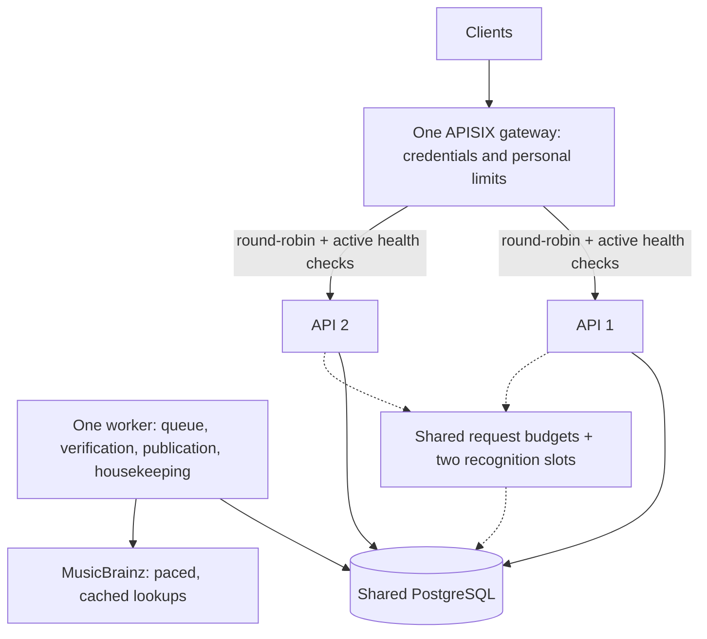

# Two API replicas behind APISIX

[Home](../README.md) · [Documentation](README.md) · [Deployment](deployment.md)

This opt-in PostgreSQL deployment runs two API containers and **one** ingestion
worker. APISIX authenticates clients and balances requests across the APIs. It
does not convert an existing SQLite installation, and it is not a complete
high-availability cluster.



## What stays shared

| Resource | Coordination |
| --- | --- |
| API membership | `FP_API_REPLICAS_ENABLED=true` uses shared PostgreSQL session locks; it requires `FP_SERVICE_ROLE=api`. Default and combined processes retain exclusive membership. |
| Ingestion worker | Exclusive session lock and worker token; a second worker is still rejected. Only the owner recovers interrupted work. |
| Queue admission | Transaction lock around duplicate checks, UTF-8 byte/count budgets and queue writes. |
| Backend request limits | PostgreSQL-clock rolling minute budgets: 60 upload/status/capability requests, 60 availability requests, 30 recognition requests and 30 statistics requests across all APIs. |
| Recognition concurrency | Two PostgreSQL session-lock slots across all APIs, covering body reading, extraction and matching. Busy requests return HTTP 429; increasing replicas does not increase this cap. |
| Gateway quotas | Existing personal and IP limits remain in the single APISIX instance. |

PostgreSQL requests use the shared budgets even when replicas are disabled, so a
mode change cannot bypass the current minute's budget. Four bounded timestamp
lists are stored under `api_rate:*` in the existing `service_state` table;
expired entries are pruned on admission. No schema or HTTP contract change is
needed. SQLite retains its existing process-local controls.

Use direct PostgreSQL connections or session-mode pooling, not transaction-mode
pooling. Slots are held on dedicated connections and checked before returning a
successful result; loss of that connection surfaces as an error. Process
ownership is checked every five seconds. Network failures can release a
session lock before old CPU work has stopped; this is not a hard distributed
CPU-resource fence during a network partition.

## Start an isolated installation

Use a **different Compose project** and ports from the live service. The example
uses new PostgreSQL and gateway-credential volumes; it contains no existing
reference collection or personal consumers.

Provide private `FP_UPLOAD_KEY`, `FP_READ_KEY`, `FP_APPLICATION_KEY`,
`FP_GATEWAY_ADMIN_KEY` and `FP_POSTGRES_PASSWORD` through your environment or a
protected external environment file. Do not commit credentials. The bundled
PostgreSQL role is for a local experiment; use a separately managed,
appropriately restricted database role and backup policy for a real deployment.

```sh
docker compose -p fingerprint-replicas -f compose.replicas.yaml up --build -d

# Native provisioning command; use the same exported internal credentials.
FP_GATEWAY_ENABLED=true \
FP_GATEWAY_BACKENDS='["api-1:8097","api-2:8097"]' \
  uv run --no-sync python -m fingerprint_server.gateway --admin-port 19180 configure

uv run --no-sync python -m fingerprint_server.gateway --admin-port 19180 \
  issue trial-user --role both
```

The gateway listens on loopback `18097`, its Admin API on loopback `19180`.
Override with `FP_REPLICA_PORT` and `FP_REPLICA_ADMIN_PORT`; match the latter
with the provisioning command's `--admin-port`. APIs, worker and PostgreSQL have
**no published host ports**. All backend services use the same credentials,
verification settings and PostgreSQL schema. A host-side provisioning command
also needs the PostgreSQL extra installed if its environment selects PostgreSQL.

`FP_GATEWAY_BACKENDS` is a JSON list of explicit DNS/IPv4 `host:port` entries.
The default remains `["fingerprints:8097"]` for existing deployments. Applying
`configure` updates the upstream and routes without replacing personal consumers.
The configuration enables active `/health` checks and disables automatic
upstream request retries, avoiding transparent POST replay.

APISIX removes an unhealthy API after health-check convergence and probes it for
recovery. During detection, requests already sent to a failing API can fail;
this is not zero-error failover. Access logs include `upstream` to show the
backend actually used. Do not trust a successful health probe as a load test.

Stop just this experiment with
`docker compose -p fingerprint-replicas -f compose.replicas.yaml down`.
Keep its volumes for later use; do not run `down --volumes` against an
installation whose data you need.

## Tested and not tested

The isolated real-APISIX test uses synthetic fingerprints and verifies that both
APIs receive traffic, a stopped API is excluded after convergence, and a
restarted API rejoins. It checks backend-wide rate/concurrency limits, HTTP
ingestion, PCM recognition and worker stop/restart. Tests create and remove only
their randomly named Compose project and volumes:

```sh
FP_TEST_POSTGRES=1 uv run --no-sync pytest -q tests/test_replicas.py
FP_RUN_REPLICA_TESTS=1 uv run --no-sync pytest -q tests/test_replicas_integration.py
```

The separate [full-collection rehearsal](benchmarks/postgresql-runtime.md#full-collection-runtime-and-restore-rehearsal)
validated 56.9 million landmarks with one API and one worker. The two-API test
does **not** establish full-collection concurrent throughput. One gateway,
PostgreSQL and the single worker remain failure domains. Worker loss makes
`/health` fail on both APIs and the gateway can report no healthy upstream.
PostgreSQL failover, multiple gateways, Kubernetes ingress, rolling schema
upgrades and sustained production-load behavior are not implemented or certified.
Adding API replicas alone is not a claim of higher recognition capacity.

The final validation run's access logs showed this distribution; each row is
a separate observation window, not a throughput comparison:

| Phase | API 1 requests | API 2 requests |
| --- | ---: | ---: |
| Both APIs ready, including readiness probe | 6 | 7 |
| API 1 stopped, health checks converged | 0 | 10 |
| API 1 restarted and healthy again | 6 | 6 |
